# Machine Learning Complete Guide

&nbsp;[Bidur Sapkota](https://www.bidursapkota.com.np/)


## Table of Contents

1. [Data Preprocessing](#data-preprocessing)
2. [Simple Linear Regression](#simple-linear-regression)
3. [Multiple Linear Regression](#multiple-linear-regression)
4. [Polynomial Regression](#polynomial-regression)
5. [Support Vector Regression (SVR)](#support-vector-regression-svr)
6. [Decision Tree Regression](#decision-tree-regression)
7. [Random Forest Regression](#random-forest-regression)
8. [Logistic Regression](#logistic-regression)
9. [K-Nearest Neighbors (K-NN)](#k-nearest-neighbors-k-nn)
10. [Support Vector Machine (SVM)](#support-vector-machine-svm)
11. [Kernel SVM](#kernel-svm)
12. [Naive Bayes](#naive-bayes)
13. [Decision Tree Classification](#decision-tree-classification)
14. [Random Forest Classification](#random-forest-classification)
15. [K-Means Clustering](#k-means-clustering)
16. [Hierarchical Clustering](#hierarchical-clustering)
17. [Apriori](#apriori)
18. [Eclat](#eclat)
19. [Upper Confidence Bound (UCB)](#upper-confidence-bound-ucb)
20. [Thompson Sampling](#thompson-sampling)
21. [Natural Language Processing](#natural-language-processing)
22. [Artificial Neural Networks (ANN)](#artificial-neural-networks-ann)
23. [Convolutional Neural Networks (CNN)](#convolutional-neural-networks-cnn)
24. [Principal Component Analysis (PCA)](#principal-component-analysis-pca)
25. [Linear Discriminant Analysis (LDA)](#linear-discriminant-analysis-lda)
26. [Kernel PCA](#kernel-pca)
27. [K-Fold Cross Validation](#k-fold-cross-validation)
28. [Grid Search](#grid-search)
29. [XGBoost](#xgboost)

---

## The ML Process

Every ML project follows three stages.

**1. Data Preprocessing** prepares raw data for modelling. This includes importing data, handling missing values, encoding categorical variables, splitting into training and test sets, and feature scaling.

**2. Modelling** builds and trains a model on the training set, then uses it to make predictions on the test set.

**3. Evaluation** measures model performance using appropriate metrics and determines whether the model is acceptable.

---

## Data Preprocessing

### Key Terminology

- **Features** are the input columns (independent variables) used to make predictions.
- **Dependent variable** is the output column the model predicts.
- **`iloc`** stands for "integer location" and is used to select rows and columns by their integer index positions.

### Sample Dataset

```csv
Country,Age,Salary,Purchased
France,44,72000,No
Spain,27,48000,Yes
Germany,30,54000,No
Spain,38,61000,No
Germany,40,,Yes
France,35,58000,Yes
Spain,,52000,No
France,48,79000,Yes
Germany,50,83000,No
France,37,67000,Yes
```

Here, `Country`, `Age`, and `Salary` are features (X). `Purchased` is the dependent variable (y). The dataset has missing values in the `Age` and `Salary` columns.

### Importing Libraries

```python
import numpy as np
import matplotlib.pyplot as plt
import pandas as pd
```

- **NumPy** provides numerical operations and array handling.
- **Matplotlib** is used for plotting charts.
- **Pandas** handles data import and manipulation via DataFrames.

### Importing the Dataset

```python
dataset = pd.read_csv('Data.csv')
X = dataset.iloc[:, :-1].values
y = dataset.iloc[:, -1].values
```

`pd.read_csv('Data.csv')` reads the CSV file and returns a DataFrame. `iloc[:, :-1]` selects all rows (`:`) and all columns except the last one (`:-1`), which gives the features. `iloc[:, -1]` selects all rows of the last column, which is the dependent variable. `.values` converts the DataFrame selection into a NumPy array, which scikit-learn expects as input.

**Important `read_csv` parameters:**

| Parameter   | Purpose                                                |
| ----------- | ------------------------------------------------------ |
| `sep`       | Delimiter to use (default `,`). Use `sep='\t'` for TSV |
| `header`    | Row number to use as column names (default `0`)        |
| `index_col` | Column to use as the row index                         |
| `na_values` | Additional strings to recognize as NaN                 |
| `encoding`  | File encoding (e.g., `'utf-8'`, `'latin-1'`)           |

```python
print(X)
```

```text
[['France' 44.0 72000.0]
 ['Spain' 27.0 48000.0]
 ['Germany' 30.0 54000.0]
 ['Spain' 38.0 61000.0]
 ['Germany' 40.0 nan]
 ['France' 35.0 58000.0]
 ['Spain' nan 52000.0]
 ['France' 48.0 79000.0]
 ['Germany' 50.0 83000.0]
 ['France' 37.0 67000.0]]
```

```python
print(y)
```

```text
['No' 'Yes' 'No' 'No' 'Yes' 'Yes' 'No' 'Yes' 'No' 'Yes']
```

### Handling Missing Data

Missing values appear as `nan`. Deleting rows with missing data loses information. A better approach is to replace each missing value with the mean of its column.

```python
from sklearn.impute import SimpleImputer
imputer = SimpleImputer(missing_values=np.nan, strategy='mean')
imputer.fit(X[:, 1:3])
X[:, 1:3] = imputer.transform(X[:, 1:3])
```

`SimpleImputer` replaces missing values based on a chosen strategy. `missing_values=np.nan` tells the imputer what to look for; the default is `np.nan`. `strategy='mean'` replaces each missing value with the mean of its column. `fit()` computes the mean of columns 1 and 2 (Age and Salary). `transform()` replaces the `nan` values with those computed means. Only numerical columns are imputed because mean is undefined for strings. `X[:, 1:3]` selects columns at index 1 and 2 (Python slicing excludes the end index).

**Important `SimpleImputer` parameters:**

| Parameter        | Purpose                                                            |
| ---------------- | ------------------------------------------------------------------ |
| `strategy`       | `'mean'` (default), `'median'`, `'most_frequent'`, `'constant'`    |
| `fill_value`     | Value to use when `strategy='constant'` (e.g., `0` or `'missing'`) |
| `missing_values` | The placeholder for missing values (default `np.nan`)              |

`'median'` is more robust to outliers than `'mean'`. `'most_frequent'` replaces with the mode, useful for categorical columns. `'constant'` fills with a fixed value specified by `fill_value`.

```python
print(X)
```

```text
[['France' 44.0 72000.0]
 ['Spain' 27.0 48000.0]
 ['Germany' 30.0 54000.0]
 ['Spain' 38.0 61000.0]
 ['Germany' 40.0 63777.77777777778]
 ['France' 35.0 58000.0]
 ['Spain' 38.77777777777778 52000.0]
 ['France' 48.0 79000.0]
 ['Germany' 50.0 83000.0]
 ['France' 37.0 67000.0]]
```

### Encoding Categorical Data

ML models work with numbers, not strings. Categorical columns must be converted.

#### One-Hot Encoding

For features/independent variables, use One-Hot Encoding. It creates one binary column per category. This avoids imposing a false numerical order (e.g., France=0, Germany=1, Spain=2 would wrongly imply Germany is "between" France and Spain).

```python
from sklearn.compose import ColumnTransformer
from sklearn.preprocessing import OneHotEncoder
ct = ColumnTransformer(transformers=[('encoder', OneHotEncoder(), [0])], remainder='passthrough')
X = np.array(ct.fit_transform(X))
```

`ColumnTransformer` applies different transformations to different columns in a single step. `transformers` takes a list of tuples in the format `(name, transformer, columns)`. `'encoder'` is a label you choose for this transformation. `OneHotEncoder()` is the transformer to apply. `[0]` specifies column index 0 (Country) as the target. `remainder='passthrough'` keeps all other columns unchanged; without this, non-specified columns are dropped by default. `fit_transform()` computes the encoding and applies it in one step. The result is wrapped in `np.array()` to ensure a consistent NumPy array format.

**Important `ColumnTransformer` parameters:**

| Parameter   | Purpose                                                                    |
| ----------- | -------------------------------------------------------------------------- |
| `remainder` | `'drop'` (default) drops untransformed columns, `'passthrough'` keeps them |

**Important `OneHotEncoder` parameters:**

| Parameter        | Purpose                                                              |
| ---------------- | -------------------------------------------------------------------- |
| `drop`           | `'first'` drops the first category to avoid multicollinearity        |
| `sparse_output`  | `False` returns a dense array instead of a sparse matrix             |
| `handle_unknown` | `'error'` (default) or `'ignore'` for unseen categories at transform |

`drop='first'` is important for linear models where having all dummy columns creates perfect multicollinearity (the dummy variable trap).

```python
print(X)
```

```text
[[1.0 0.0 0.0 44.0 72000.0]
 [0.0 0.0 1.0 27.0 48000.0]
 [0.0 1.0 0.0 30.0 54000.0]
 [0.0 0.0 1.0 38.0 61000.0]
 [0.0 1.0 0.0 40.0 63777.77777777778]
 [1.0 0.0 0.0 35.0 58000.0]
 [0.0 0.0 1.0 38.77777777777778 52000.0]
 [1.0 0.0 0.0 48.0 79000.0]
 [0.0 1.0 0.0 50.0 83000.0]
 [1.0 0.0 0.0 37.0 67000.0]]
```

The three Country values become three binary columns: `[France, Germany, Spain]`.

#### Label Encoding (Dependent Variable)

For the dependent variable, use Label Encoding. It converts categories into integers. This is acceptable here because the model treats y as a label, not a numeric value with magnitude.

```python
from sklearn.preprocessing import LabelEncoder
le = LabelEncoder()
y = le.fit_transform(y)
```

`LabelEncoder` assigns an integer to each unique class in alphabetical order. `fit_transform()` learns the mapping and applies it in one step. `le.classes_` stores the original class labels if you need to reverse the encoding later using `le.inverse_transform()`.

```python
print(y)
```

```text
[0 1 0 0 1 1 0 1 0 1]
```

`No` becomes 0 and `Yes` becomes 1.

### Splitting the Dataset

The training set is used to train the model. The test set is used to evaluate it on unseen data. A typical split is 80% training and 20% test.

```python
from sklearn.model_selection import train_test_split
X_train, X_test, y_train, y_test = train_test_split(X, y, test_size = 0.2, random_state = 1)
```

`train_test_split` shuffles the data and splits it into training and test subsets. `X, y` are the feature matrix and target vector to split. `test_size=0.2` allocates 20% of the data to the test set and the remaining 80% to training. `random_state=1` fixes the random seed so the split is reproducible; any integer works, but using the same value always produces the same split.

**Important `train_test_split` parameters:**

| Parameter      | Purpose                                                                      |
| -------------- | ---------------------------------------------------------------------------- |
| `test_size`    | Fraction (`0.2`), integer (count), or `None`. Default is `0.25`              |
| `train_size`   | Complement of `test_size`. Can specify instead of or along with it           |
| `random_state` | Seed for reproducibility. `None` (default) uses a different split each time  |
| `shuffle`      | `True` (default) shuffles data before splitting. Set `False` for time-series |
| `stratify`     | Pass `y` to ensure the class ratio is preserved in both sets                 |

`stratify=y` is important for imbalanced datasets. If 90% of samples are class A and 10% are class B, stratification ensures both the training and test sets maintain this 90/10 ratio.

```python
print(X_train)
```

```text
[[0.0 0.0 1.0 38.77777777777778 52000.0]
 [0.0 1.0 0.0 40.0 63777.77777777778]
 [1.0 0.0 0.0 44.0 72000.0]
 [0.0 0.0 1.0 38.0 61000.0]
 [0.0 0.0 1.0 27.0 48000.0]
 [1.0 0.0 0.0 48.0 79000.0]
 [0.0 1.0 0.0 50.0 83000.0]
 [1.0 0.0 0.0 35.0 58000.0]]
```

```python
print(X_test)
```

```text
[[0.0 1.0 0.0 30.0 54000.0]
 [1.0 0.0 0.0 37.0 67000.0]]
```

```python
print(y_train)
```

```text
[0 1 0 0 1 1 0 1]
```

```python
print(y_test)
```

```text
[0 1]
```

### Feature Scaling

Features with vastly different ranges (e.g., Age: 27-50 vs Salary: 48000-83000) can cause some features to dominate the model. Feature scaling brings all features to a comparable range. It is always applied column-wise, not across columns or rows.

#### Normalization (Min-Max Scaling)

$$X' = \frac{X - X_{min}}{X_{max} - X_{min}}$$

Rescales values to the range **[0, 1]**. Best for algorithms that require bounded inputs (k-NN, Neural Networks) or when the data does not follow a normal distribution. Sensitive to outliers.

#### Standardization (Z-Score Scaling)

$$X' = \frac{X - \mu}{\sigma}$$

Rescales values to have mean = 0 and standard deviation = 1. Most values fall in [-3, +3]. Works well for most algorithms (Linear Regression, SVM, PCA). Less sensitive to outliers.

#### Which to Choose?

Standardization is the safer default because it works regardless of the data distribution. Use normalization when the algorithm explicitly requires bounded input values.

#### Why Scale After Splitting?

Feature scaling must happen after the train-test split to avoid data leakage. If you scale before splitting, the mean, standard deviation, min, and max are computed using test data too. This means the model indirectly "sees" test data during training, producing overly optimistic results that will not generalize.

The correct workflow: fit the scaler on the training set only, then apply that same transformation to the test set.

#### Should One-Hot Columns Be Scaled?

No. One-hot encoded columns are already 0 or 1. Scaling them would distort their meaning as binary indicators and offers no benefit.

#### Applying Standardization

```python
from sklearn.preprocessing import StandardScaler
sc = StandardScaler()
X_train[:, 3:] = sc.fit_transform(X_train[:, 3:])
X_test[:, 3:] = sc.transform(X_test[:, 3:])
```

`StandardScaler` transforms features by removing the mean and scaling to unit variance. `fit_transform()` computes the mean ($\mu$) and standard deviation ($\sigma$) from the training set and applies the transformation $\frac{X - \mu}{\sigma}$ in one step. `transform()` applies the same training-set parameters ($\mu$ and $\sigma$) to the test set without refitting, preventing data leakage. `X_train[:, 3:]` selects columns from index 3 onward (Age, Salary), leaving the one-hot encoded columns (0, 1, 2) untouched.

**Important `StandardScaler` parameters:**

| Parameter   | Purpose                                                                            |
| ----------- | ---------------------------------------------------------------------------------- |
| `with_mean` | `True` (default) centers data by subtracting the mean. Set `False` for sparse data |
| `with_std`  | `True` (default) scales data to unit variance                                      |

**Alternative scalers in scikit-learn:**

| Scaler         | Purpose                                                                |
| -------------- | ---------------------------------------------------------------------- |
| `MinMaxScaler` | Scales to a given range, default [0, 1]. Use `feature_range` to change |
| `RobustScaler` | Uses median and IQR instead of mean and std. Robust to outliers        |
| `MaxAbsScaler` | Scales by the maximum absolute value. Good for sparse data             |
| `Normalizer`   | Scales each sample (row) to unit norm, not each feature                |

```python
print(X_train)
```

```text
[[0.0 0.0 1.0 -0.19159184384578545 -1.0781259408412425]
 [0.0 1.0 0.0 -0.014117293757057777 -0.07013167641635372]
 [1.0 0.0 0.0 0.566708506533324 0.633562432710455]
 [0.0 0.0 1.0 -0.30453019390224867 -0.30786617274297867]
 [0.0 0.0 1.0 -1.9018011447007988 -1.420463615551582]
 [1.0 0.0 0.0 1.1475343068237058 1.232653363453549]
 [0.0 1.0 0.0 1.4379472069688968 1.5749910381638885]
 [1.0 0.0 0.0 -0.7401495441200351 -0.5646194287757332]]
```

```python
print(X_test)
```

```text
[[0.0 1.0 0.0 -1.4661817944830124 -0.9069571034860727]
 [1.0 0.0 0.0 -0.44973664397484414 0.2056403393225306]]
```

Only columns 3 onward (Age, Salary) are scaled. The one-hot encoded columns (0, 1, 2) remain untouched.

---

## Simple Linear Regression

Regression models predict a continuous real value. Simple Linear Regression models the relationship between one independent variable (X) and one dependent variable (y) as a straight line.

**Formula:**

$$\hat{y} = b_0 + b_1 X_1$$

- $\hat{y}$: predicted value (dependent variable)
- $b_0$: y-intercept (the value of y when X = 0)
- $b_1$: slope coefficient (how much y changes per unit change in X)
- $X_1$: independent variable

**Example:** Predicting potato yield from fertilizer: $Potatoes[t] = 8 + 3 \times Fertilizer[kg]$. Here $b_0 = 8$ tons (base yield) and $b_1 = 3$ tons/kg (yield gain per kg of fertilizer).

### Ordinary Least Squares (OLS)

OLS finds the best-fit line by choosing $b_0$ and $b_1$ that minimize the sum of squared residuals.

**Residual:** the difference between the observed value and the predicted value.

$$\epsilon_i = y_i - \hat{y}_i$$

**Objective:** minimize $\sum (y_i - \hat{y}_i)^2$

This ensures the line is as close as possible to all data points collectively.

### Sample Dataset

```csv
YearsExperience,Salary
1.1,39343.00
1.3,46205.00
1.5,37731.00
2.0,43525.00
2.2,39891.00
2.9,56642.00
3.0,60150.00
3.2,54445.00
3.2,64445.00
3.7,57189.00
3.9,63218.00
4.0,55794.00
4.0,56957.00
4.1,57081.00
4.5,61111.00
4.9,67938.00
5.1,66029.00
5.3,83088.00
5.9,81363.00
6.0,93940.00
6.8,91738.00
7.1,98273.00
7.9,101302.00
8.2,113812.00
8.7,109431.00
9.0,105582.00
9.5,116969.00
9.6,112635.00
10.3,122391.00
10.5,121872.00
```

### Importing Libraries

```python
import numpy as np
import matplotlib.pyplot as plt
import pandas as pd
```

### Importing the Dataset

```python
dataset = pd.read_csv('Salary_Data.csv')
X = dataset.iloc[:, :-1].values
y = dataset.iloc[:, -1].values
```

### Splitting the Dataset

```python
from sklearn.model_selection import train_test_split
X_train, X_test, y_train, y_test = train_test_split(X, y, test_size = 1/3, random_state = 0)
```

`test_size=1/3` allocates one-third of the data (10 observations) to the test set and the remaining two-thirds (20 observations) to training. `random_state=0` fixes the seed for reproducibility.

Feature scaling is not required for Simple Linear Regression because the `LinearRegression` class handles it internally.

### Training the Model

```python
from sklearn.linear_model import LinearRegression
regressor = LinearRegression()
regressor.fit(X_train, y_train)
```

`LinearRegression()` creates a linear regression model using Ordinary Least Squares. `fit(X_train, y_train)` computes the optimal $b_0$ (intercept) and $b_1$ (slope) by minimizing the sum of squared residuals on the training data. After fitting, the model stores these values in `regressor.intercept_` and `regressor.coef_`.

**Important `LinearRegression` parameters:**

| Parameter       | Purpose                                                                                           |
| --------------- | ------------------------------------------------------------------------------------------------- |
| `fit_intercept` | `True` (default) calculates the intercept $b_0$. Set `False` to force the line through the origin |
| `copy_X`        | `True` (default) copies X before fitting. Set `False` to modify X in place and save memory        |
| `n_jobs`        | Number of CPU cores for computation. `None` (default) uses 1 core. `-1` uses all cores            |
| `positive`      | `False` (default). Set `True` to force all coefficients to be positive                            |

`fit_intercept=False` is used when you know the relationship passes through the origin (e.g., zero input means zero output). `n_jobs` only affects multi-target regression (multiple y columns); for single-target regression it has no effect.

### Predicting Results

```python
y_pred = regressor.predict(X_test)
```

`predict(X_test)` takes the test features and returns predicted salary values using the learned equation $\hat{y} = b_0 + b_1 X_1$. The input must be a 2D array (matrix), which is why `X_test` from `iloc` already has the correct shape.

### Visualizing Results

#### Training Set

```python
plt.scatter(X_train, y_train, color = 'red')
plt.plot(X_train, regressor.predict(X_train), color = 'blue')
plt.title('Salary vs Experience (Training set)')
plt.xlabel('Years of Experience')
plt.ylabel('Salary')
plt.show()
```

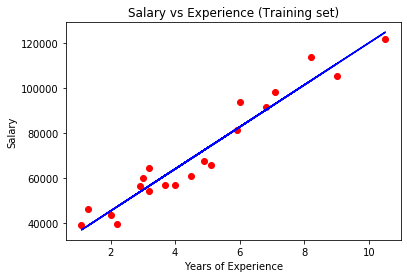

`plt.scatter(X_train, y_train, color='red')` plots the actual training data as red dots. `plt.plot(X_train, regressor.predict(X_train), color='blue')` draws the regression line in blue by plotting predicted values against the training features. `plt.title()`, `plt.xlabel()`, and `plt.ylabel()` set the chart title and axis labels. `plt.show()` renders and displays the plot.

**Important `plt.scatter` parameters:**

| Parameter | Purpose                                                                       |
| --------- | ----------------------------------------------------------------------------- |
| `s`       | Marker size in points² (default `20`)                                         |
| `c`       | Color or array of colors for each point                                       |
| `marker`  | Marker shape: `'o'` (default circle), `'s'` (square), `'^'` (triangle), `'x'` |
| `alpha`   | Transparency from 0 (invisible) to 1 (opaque)                                 |
| `label`   | Legend label for this dataset                                                 |

#### Test Set

```python
plt.scatter(X_test, y_test, color = 'red')
plt.plot(X_train, regressor.predict(X_train), color = 'blue')
plt.title('Salary vs Experience (Test set)')
plt.xlabel('Years of Experience')
plt.ylabel('Salary')
plt.show()
```

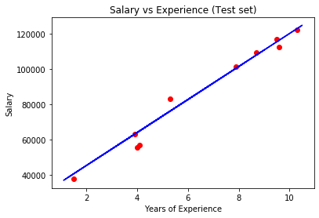

The regression line is the same (trained on the training set). The red dots are the actual test data points. The closer the dots are to the line, the better the model. Note that `plt.plot` still uses `X_train` to draw the line because the model was trained on that data; the line itself does not change.

### Single Prediction

```python
print(regressor.predict([[12]]))
```

```text
[138967.5015615]
```

The model predicts a salary of approximately $138,968 for an employee with 12 years of experience.

The input `[[12]]` uses double brackets because `predict()` expects a 2D array: the outer brackets create a list of samples, and the inner brackets define a single sample with one feature.

### Extracting the Equation

```python
print(regressor.coef_)
print(regressor.intercept_)
```

```text
[9345.94244312]
26816.192244031183
```

The final regression equation is:

$$Salary = 9345.94 \times YearsExperience + 26816.19$$

`coef_` returns an array of slope coefficients ($b_1$). It is an array because in multiple regression there would be one coefficient per feature. `intercept_` returns the y-intercept ($b_0$) as a single float. Together they define the complete linear equation. You can also compute the model's $R^2$ score using `regressor.score(X_test, y_test)`, which returns a value between 0 and 1 indicating how well the model explains the variance in the data.

---

## Multiple Linear Regression

Multiple Linear Regression extends Simple Linear Regression to multiple independent variables. Instead of fitting a line in 2D, it fits a hyperplane in higher-dimensional space.

**Formula:**

$$\hat{y} = b_0 + b_1 X_1 + b_2 X_2 + \dots + b_n X_n$$

- $\hat{y}$: predicted value (dependent variable)
- $b_0$: y-intercept (constant term, the value of y when all X's are 0)
- $b_1, b_2, \dots, b_n$: slope coefficients (how much y changes per unit change in each respective X, holding all other X's constant)
- $X_1, X_2, \dots, X_n$: independent variables

**Example:** Predicting profit from R&D spend, admin cost, and marketing spend: $Profit = b_0 + b_1 \times R\&D + b_2 \times Admin + b_3 \times Marketing$.

### Assumptions of Linear Regression

Before building a linear regression model, five assumptions must hold for the results to be reliable. These apply to both simple and multiple linear regression.

**1. Linearity** — There must be a linear relationship between the dependent variable and each independent variable. If the true relationship is curved, a linear model will systematically mispredict. Check with scatter plots of y vs each X.

**2. Homoscedasticity** — The variance of the residuals (errors) must be constant across all levels of the independent variables. If the spread of residuals increases or decreases with the predicted value (heteroscedasticity), the model's confidence intervals and p-values become unreliable. Check by plotting residuals vs predicted values.

**3. Multivariate Normality** — The residuals must be normally distributed. This assumption is needed for hypothesis testing (p-values, confidence intervals) to be valid. With large sample sizes, this becomes less critical due to the Central Limit Theorem. Check with a Q-Q plot or histogram of residuals.

**4. Independence** — Observations must be independent of each other. There should be no autocorrelation (where residuals are correlated with each other). This is especially relevant in time-series data where consecutive observations may be related. Check with the Durbin-Watson test.

**5. No Multicollinearity** — Independent variables must not be highly correlated with each other. If $X_1$ and $X_2$ are strongly correlated, the model cannot reliably determine the individual effect of each variable. This inflates the variance of coefficient estimates and makes them unstable. Check with the Variance Inflation Factor (VIF); a VIF above 5-10 indicates problematic multicollinearity.

Additionally, always check for outliers. Outliers are not an assumption but can heavily influence the regression line, especially in small datasets. Use leverage plots and Cook's distance to identify influential points.

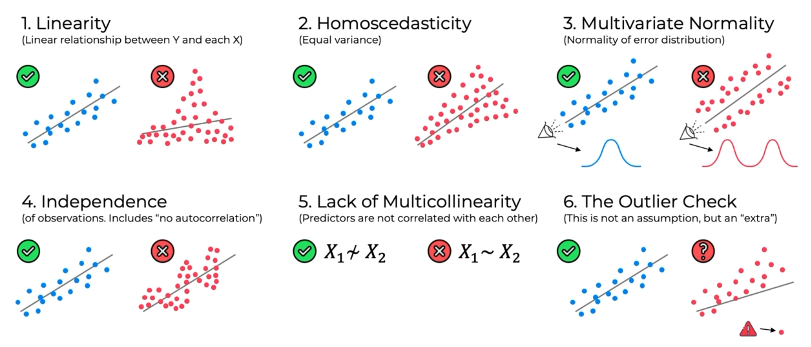

### Dummy Variables

Categorical variables (e.g., State: New York, California) cannot be used directly in the regression equation. They must be converted into numerical form using dummy variables.

**Example Dataset:**

| Profit     | R&D Spend  | Admin      | Marketing  | State      |
| ---------- | ---------- | ---------- | ---------- | ---------- |
| 192,261.83 | 165,349.20 | 136,897.80 | 471,784.10 | New York   |
| 191,792.06 | 162,597.70 | 151,377.59 | 443,898.53 | California |
| 191,050.39 | 153,441.51 | 101,145.55 | 407,934.54 | California |
| 182,901.99 | 144,372.41 | 118,671.85 | 383,199.62 | New York   |
| 166,187.94 | 142,107.34 | 91,391.77  | 366,168.42 | California |

One-Hot Encoding creates a binary column for each category:

| New York | California |
| -------- | ---------- |
| 1        | 0          |
| 0        | 1          |
| 0        | 1          |
| 1        | 0          |
| 0        | 1          |

The regression equation becomes:

$$y = b_0 + b_1 \cdot X_1 + b_2 \cdot X_2 + b_3 \cdot X_3 + b_4 \cdot D_1$$

Where $X_1, X_2, X_3$ are the numerical features (R&D, Admin, Marketing) and $D_1$ is the dummy variable for one state.

#### The Dummy Variable Trap

If a categorical variable has $n$ categories, you must include only $n - 1$ dummy columns. Including all $n$ creates perfect multicollinearity because one column can always be predicted from the others (e.g., if New York = 0, then California must = 1). This is called the dummy variable trap.

**Always omit one dummy variable.** The omitted category becomes the baseline, and the coefficients of the remaining dummies represent the difference relative to that baseline. For example, if California is omitted, the coefficient of New York tells you how much more (or less) profit New York generates compared to California, all else equal.

Note: scikit-learn's `LinearRegression` does not require you to manually drop a dummy column because it can handle the multicollinearity internally. However, for statistical models (e.g., `statsmodels`), you must drop one column or use `OneHotEncoder(drop='first')`.

### Statistical Significance & P-Values

Statistical significance determines whether a predictor actually has a real effect on the dependent variable or whether the observed relationship is due to random chance.

**Null Hypothesis ($H_0$):** The predictor has no effect on the dependent variable (its coefficient is zero).

**Alternative Hypothesis ($H_1$):** The predictor does have an effect (its coefficient is not zero).

The **p-value** is the probability of observing the data (or something more extreme) assuming $H_0$ is true. A small p-value means it is unlikely the result occurred by chance.

**Significance Level ($\alpha$):** The threshold for rejecting $H_0$, typically set to 0.05 (5%).

- If p-value < $\alpha$ (e.g., p < 0.05): Reject $H_0$. The predictor is statistically significant.
- If p-value ≥ $\alpha$ (e.g., p ≥ 0.05): Fail to reject $H_0$. The predictor is not statistically significant and may not belong in the model.

### Building a Model

With multiple potential predictors, you need to decide which variables to include. There are five methods for building a model.

#### All-In

Include all predictors in the model. Use when:

- You have prior knowledge that all variables are relevant.
- The domain requires it (e.g., regulatory compliance).
- You are preparing for Backward Elimination.

#### Backward Elimination

1. Select a significance level to stay in the model (e.g., SL = 0.05).
2. Fit the full model with all predictors.
3. Find the predictor with the highest p-value. If p > SL, go to step 4. Otherwise, the model is ready (FIN).
4. Remove that predictor.
5. Refit the model without the removed variable. Go back to step 3.

This starts with everything and removes one variable at a time until all remaining predictors are significant.

#### Forward Selection

1. Select a significance level to enter the model (e.g., SL = 0.05).
2. Fit all simple regression models ($y \sim X_n$). Select the predictor with the lowest p-value.
3. Keep this variable and fit all possible models with one extra predictor added to the current set.
4. Find the predictor with the lowest p-value among the new additions. If p < SL, go to step 3. Otherwise, the model is ready (FIN — keep the previous model, not the last one tested).

This starts with nothing and adds one variable at a time until no more significant predictors can be added.

#### Bidirectional Elimination

1. Select two significance levels: SL_ENTER (to enter, e.g., 0.05) and SL_STAY (to stay, e.g., 0.05).
2. Perform the next step of Forward Selection (new variables must have p < SL_ENTER to enter).
3. Perform all steps of Backward Elimination (existing variables must have p < SL_STAY to stay).
4. Repeat steps 2-3 until no new variables can enter and no existing variables can exit. The model is ready (FIN).

This combines both methods to prevent variables that were added early from remaining in the model when they become insignificant after other variables are added.

#### All Possible Models (Score Comparison)

1. Select a criterion of goodness of fit (e.g., Akaike Information Criterion, $R^2_{adj}$, BIC).
2. Construct all possible regression models: $2^N - 1$ total combinations for N predictors.
3. Select the model with the best criterion score.

This is the most thorough approach but computationally expensive. With 10 predictors, there are 1,023 possible models. With 20 predictors, over 1 million.

> **Note:** Backward Elimination, Forward Selection, and Bidirectional Elimination are collectively known as Stepwise Regression. In practice, Backward Elimination is the most commonly used because it is fast and straightforward.

### Sample Dataset

```csv
R&D Spend,Administration,Marketing Spend,State,Profit
165349.2,136897.8,471784.1,New York,192261.83
162597.7,151377.59,443898.53,California,191792.06
153441.51,101145.55,407934.54,Florida,191050.39
144372.41,118671.85,383199.62,New York,182901.99
142107.34,91391.77,366168.42,Florida,166187.94
131876.9,99814.71,362861.36,New York,156991.12
134615.46,147198.87,127716.82,California,156122.51
130298.13,145530.06,323876.68,Florida,155752.6
120542.52,148718.95,311613.29,New York,152211.77
123334.88,108679.17,304981.62,California,149759.96
101913.08,110594.11,229160.95,Florida,146121.95
100671.96,91790.61,249744.55,California,144259.4
93863.75,127320.38,249839.44,Florida,141585.52
91992.39,135495.07,252664.93,California,134307.35
119943.24,156547.42,256512.92,Florida,132602.65
114523.61,122616.84,261776.23,New York,129917.04
78013.11,121597.55,264346.06,California,126992.93
94657.16,145077.58,282574.31,New York,125370.37
91749.16,114175.79,294919.57,Florida,124266.9
86419.7,153514.11,0,New York,122776.86
76253.86,113867.3,298664.47,California,118474.03
78389.47,153773.43,299737.29,New York,111313.02
73994.56,122782.75,303319.26,Florida,110352.25
67532.53,105751.03,304768.73,Florida,108733.99
77044.01,99281.34,140574.81,New York,108552.04
64664.71,139553.16,137962.62,California,107404.34
75328.87,144135.98,134050.07,Florida,105733.54
72107.6,127864.55,353183.81,New York,105008.31
66051.52,182645.56,118148.2,Florida,103282.38
65605.48,153032.06,107138.38,New York,101004.64
61994.48,115641.28,91131.24,Florida,99937.59
61136.38,152701.92,88218.23,New York,97483.56
63408.86,129219.61,46085.25,California,97427.84
55493.95,103057.49,214634.81,Florida,96778.92
46426.07,157693.92,210797.67,California,96712.8
46014.02,85047.44,205517.64,New York,96479.51
28663.76,127056.21,201126.82,Florida,90708.19
44069.95,51283.14,197029.42,California,89949.14
20229.59,65947.93,185265.1,New York,81229.06
38558.51,82982.09,174999.3,California,81005.76
28754.33,118546.05,172795.67,California,78239.91
27892.92,84710.77,164470.71,Florida,77798.83
23640.93,96189.63,148001.11,California,71498.49
15505.73,127382.3,35534.17,New York,69758.98
22177.74,154806.14,28334.72,California,65200.33
1000.23,124153.04,1903.93,New York,64926.08
1315.46,115816.21,297114.46,Florida,49490.75
0,135426.92,0,California,42559.73
542.05,51743.15,0,New York,35673.41
0,116983.8,45173.06,California,14681.4
```

### Importing Libraries

```python
import numpy as np
import matplotlib.pyplot as plt
import pandas as pd
```

### Importing the Dataset

```python
dataset = pd.read_csv('50_Startups.csv')
X = dataset.iloc[:, :-1].values
y = dataset.iloc[:, -1].values
```

`iloc[:, :-1]` selects the first four columns (R&D Spend, Administration, Marketing Spend, State) as features. `iloc[:, -1]` selects the last column (Profit) as the dependent variable.

### Encoding Categorical Data

```python
from sklearn.compose import ColumnTransformer
from sklearn.preprocessing import OneHotEncoder
ct = ColumnTransformer(transformers=[('encoder', OneHotEncoder(), [3])], remainder='passthrough')
X = np.array(ct.fit_transform(X))
```

`[3]` targets column index 3 (State). `OneHotEncoder()` converts the three states (California, Florida, New York) into three binary columns. `remainder='passthrough'` keeps R&D Spend, Administration, and Marketing Spend unchanged.

You do not need to manually avoid the dummy variable trap here. The `LinearRegression` class in scikit-learn handles multicollinearity internally, so including all dummy columns does not cause issues.

### Splitting the Dataset

```python
from sklearn.model_selection import train_test_split
X_train, X_test, y_train, y_test = train_test_split(X, y, test_size = 0.2, random_state = 0)
```

`test_size=0.2` gives 40 training samples and 10 test samples from the 50 startups.

### Training the Model

```python
from sklearn.linear_model import LinearRegression
regressor = LinearRegression()
regressor.fit(X_train, y_train)
```

`LinearRegression` automatically handles multiple features. `fit()` computes $b_0, b_1, \dots, b_n$ by minimizing the sum of squared residuals across all features simultaneously. There is no need for feature scaling or manual feature selection; the class handles everything internally.

### Predicting Results

```python
y_pred = regressor.predict(X_test)
np.set_printoptions(precision=2)
print(np.concatenate((y_pred.reshape(len(y_pred),1), y_test.reshape(len(y_test),1)),1))
```

```text
[[103015.2  103282.38]
 [132582.28 144259.4 ]
 [132447.74 146121.95]
 [  71976.1   77798.83]
 [ 178537.48 191050.39]
 [ 116161.24 105008.31]
 [  67851.69  81229.06]
 [  98791.73  97483.56]
 [ 113969.44 110352.25]
 [ 167921.07 166187.94]]
```

`np.set_printoptions(precision=2)` limits NumPy output to 2 decimal places for readability. `reshape(len(y_pred), 1)` converts each 1D array into a column vector. `np.concatenate(..., 1)` joins the predicted and actual values side by side (axis=1) for easy comparison. The left column is the predicted profit and the right column is the actual profit.

### Single Prediction

```python
print(regressor.predict([[1, 0, 0, 160000, 130000, 300000]]))
```

```text
[181566.92]
```

The model predicts a profit of approximately `$181,567` for a startup in California (encoded as `[1, 0, 0]`) with R&D spend of `$160,000`, admin spend of `$130,000`, and marketing spend of `$300,000`. The dummy variables come first because `ColumnTransformer` placed the encoded columns before the passthrough columns.

### Extracting the Equation

```python
print(regressor.coef_)
print(regressor.intercept_)
```

```text
[ 8.66e+01 -8.73e+02  7.86e+02  7.73e-01  3.29e-02  3.66e-02]
42467.53
```

`coef_` returns one coefficient per feature: three for the dummy variables and three for the numerical features. `intercept_` returns $b_0$. The coefficients show that R&D Spend (`7.73e-01`) has the largest effect on profit, while Administration (`3.29e-02`) and Marketing Spend (`3.66e-02`) have much smaller effects. This means for every dollar increase in R&D spend, profit increases by approximately $0.77, holding all other variables constant.

### Backward Elimination (Manual Implementation)

Backward Elimination removes predictors one at a time based on their p-values until only statistically significant variables remain. This implementation uses `statsmodels` for access to p-values, which scikit-learn's `LinearRegression` does not provide.

**Same upto "Encoding Categorical Data" as in Multiple Linear Regression.**

#### Avoiding the Dummy Variable Trap

```python
X = X[:, 1:]
```

When using `statsmodels`, you must manually drop one dummy column to avoid perfect multicollinearity. This removes the first dummy column so the remaining dummies encode the categorical variable without redundancy.

#### Adding the Constant Column

```python
import statsmodels.api as sm
X = np.append(arr = np.ones((50, 1)).astype(int), values = X, axis = 1)
```

`statsmodels` OLS does not automatically include an intercept term ($b_0$). `np.ones((50, 1))` creates a column of 1s (one for each of the 50 observations). `np.append(..., axis=1)` prepends this column to the feature matrix so the model can fit an intercept.

#### Iterative Elimination

```python
X_opt = X[:, [0, 1, 2, 3, 4, 5]]
X_opt = X_opt.astype(np.float64)
regressor_OLS = sm.OLS(endog = y, exog = X_opt).fit()
regressor_OLS.summary()
```

Start with all predictors. `sm.OLS(endog=y, exog=X_opt).fit()` fits an Ordinary Least Squares model. `endog` is the dependent variable and `exog` is the matrix of independent variables (including the constant). `.summary()` prints a detailed table including each predictor's coefficient, standard error, t-statistic, and p-value.

Examine the p-values in the summary. Remove the predictor with the highest p-value if it exceeds the significance level (0.05), then refit:

```python
X_opt = X[:, [0, 1, 3, 4, 5]]
X_opt = X_opt.astype(np.float64)
regressor_OLS = sm.OLS(endog = y, exog = X_opt).fit()
regressor_OLS.summary()
```

Column 2 (one of the dummy variables) had the highest p-value and was removed. Continue the process:

```python
X_opt = X[:, [0, 3, 4, 5]]
X_opt = X_opt.astype(np.float64)
regressor_OLS = sm.OLS(endog = y, exog = X_opt).fit()
regressor_OLS.summary()
```

```python
X_opt = X[:, [0, 3, 5]]
X_opt = X_opt.astype(np.float64)
regressor_OLS = sm.OLS(endog = y, exog = X_opt).fit()
regressor_OLS.summary()
```

```python
X_opt = X[:, [0, 3]]
X_opt = X_opt.astype(np.float64)
regressor_OLS = sm.OLS(endog = y, exog = X_opt).fit()
regressor_OLS.summary()
```

At each step, the predictor with the highest p-value above 0.05 is removed. The process ends when all remaining predictors have p-values below 0.05. The final model retains only the constant (column 0) and R&D Spend (column 3), confirming that R&D Spend is the most statistically significant predictor of profit.

---

## Polynomial Regression

Polynomial Regression extends Linear Regression by adding polynomial terms of the independent variable as additional features. Despite the name, it is still a "linear" model because the equation is linear in its coefficients — the non-linearity comes from the transformed features ($X^2, X^3, \dots$).

**Formula:**

$$\hat{y} = b_0 + b_1 X_1 + b_2 X_1^2 + \dots + b_n X_1^n$$

- $\hat{y}$: predicted value
- $b_0$: intercept
- $b_1, b_2, \dots, b_n$: coefficients for each polynomial term
- $X_1$: independent variable
- $n$: degree of the polynomial

**When to use:** When the relationship between X and y is curvilinear and a straight line would systematically mispredict. Common examples include salary progression by job level, population growth, and diminishing returns in economics.

### Sample Dataset

```csv
Position,Level,Salary
Business Analyst,1,45000
Junior Consultant,2,50000
Senior Consultant,3,60000
Manager,4,80000
Country Manager,5,110000
Region Manager,6,150000
Partner,7,200000
Senior Partner,8,300000
C-level,9,500000
CEO,10,1000000
```

### Importing Libraries

```python
import numpy as np
import matplotlib.pyplot as plt
import pandas as pd
```

### Importing the Dataset

```python
dataset = pd.read_csv('Position_Salaries.csv')
X = dataset.iloc[:, 1:-1].values
y = dataset.iloc[:, -1].values
```

`iloc[:, 1:-1]` selects only the Level column (index 1), skipping Position (index 0) which is just a label. `iloc[:, -1]` selects Salary as the dependent variable.

### Training the Linear Regression Model

```python
from sklearn.linear_model import LinearRegression
lin_reg = LinearRegression()
lin_reg.fit(X, y)
```

A standard linear regression is trained on the entire dataset for comparison. The entire dataset is used (no train-test split) because there are only 10 data points — splitting would leave too little data for meaningful training.

### Training the Polynomial Regression Model

```python
from sklearn.preprocessing import PolynomialFeatures
poly_reg = PolynomialFeatures(degree = 4)
X_poly = poly_reg.fit_transform(X)
lin_reg_2 = LinearRegression()
lin_reg_2.fit(X_poly, y)
```

`PolynomialFeatures(degree=4)` creates a transformer that generates polynomial features up to degree 4. For a single feature $X$, `fit_transform(X)` produces the matrix $[1, X, X^2, X^3, X^4]$. `lin_reg_2` is a standard `LinearRegression` model fitted on these polynomial features. The result is a polynomial curve, even though the underlying model is still linear in its coefficients.

**Important `PolynomialFeatures` parameters:**

| Parameter          | Purpose                                                                                      |
| ------------------ | -------------------------------------------------------------------------------------------- |
| `degree`           | Maximum degree of polynomial features (default `2`)                                          |
| `interaction_only` | `False` (default). If `True`, only interaction features are produced (no $X^2$, $X^3$, etc.) |
| `include_bias`     | `True` (default) includes a column of 1s for the intercept term                              |

Choosing the right degree is critical. Too low and the model underfits (misses the pattern). Too high and the model overfits (fits noise instead of the true relationship).

### Visualising the Linear Regression Results

```python
plt.scatter(X, y, color = 'red')
plt.plot(X, lin_reg.predict(X), color = 'blue')
plt.title('Truth or Bluff (Linear Regression)')
plt.xlabel('Position Level')
plt.ylabel('Salary')
plt.show()
```

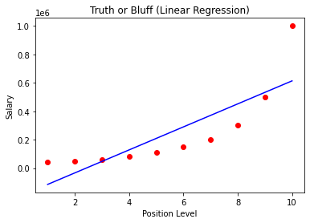

The straight line clearly fails to capture the exponential salary growth at higher levels. This demonstrates that a linear model is inappropriate for this relationship.

### Visualising the Polynomial Regression Results

```python
plt.scatter(X, y, color = 'red')
plt.plot(X, lin_reg_2.predict(poly_reg.fit_transform(X)), color = 'blue')
plt.title('Truth or Bluff (Polynomial Regression)')
plt.xlabel('Position level')
plt.ylabel('Salary')
plt.show()
```


The polynomial curve follows the data points much more closely. `poly_reg.fit_transform(X)` must be called again to generate the polynomial features that `lin_reg_2` expects as input.

### Visualising with Higher Resolution

```python
X_grid = np.arange(min(X), max(X), 0.1)
X_grid = X_grid.reshape((len(X_grid), 1))
plt.scatter(X, y, color = 'red')
plt.plot(X_grid, lin_reg_2.predict(poly_reg.fit_transform(X_grid)), color = 'blue')
plt.title('Truth or Bluff (Polynomial Regression)')
plt.xlabel('Position level')
plt.ylabel('Salary')
plt.show()
```

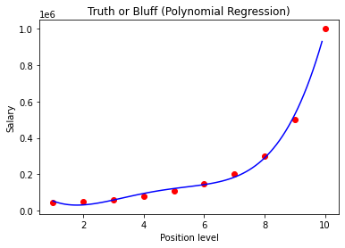

`np.arange(min(X), max(X), 0.1)` creates a finer grid of X values with 0.1 step size instead of integer steps. `reshape((len(X_grid), 1))` converts the 1D array into a 2D column vector. This produces a smoother curve that better reveals the polynomial shape, especially between data points.

### Predicting with Linear Regression

```python
print(lin_reg.predict([[6.5]]))
```

```text
[330378.78787879]
```

The linear model predicts a salary of approximately $330,379 for level 6.5.

### Predicting with Polynomial Regression

```python
print(lin_reg_2.predict(poly_reg.fit_transform([[6.5]])))
```

```text
[158862.45265155]
```

The polynomial model predicts a salary of approximately $158,862 for level 6.5. This is far more reasonable — level 6 earns $150,000 and level 7 earns $200,000, so $158,862 is a plausible interpolation. The linear model's prediction of $330,379 is clearly unrealistic, demonstrating why choosing the right model type matters.

---

## Support Vector Regression (SVR)

Support Vector Regression applies the principles of Support Vector Machines to regression problems. Instead of finding a hyperplane that best separates classes (as in SVM classification), SVR finds a hyperplane that best fits the data within a margin of tolerance ($\epsilon$).

In **linear SVR**, the model fits a straight tube (epsilon-insensitive band) around the data. Points inside the tube contribute no loss; only points outside the tube are penalized.


In **non-linear SVR**, a kernel function (such as RBF) maps the data into a higher-dimensional space where a linear tube can capture non-linear relationships in the original space.

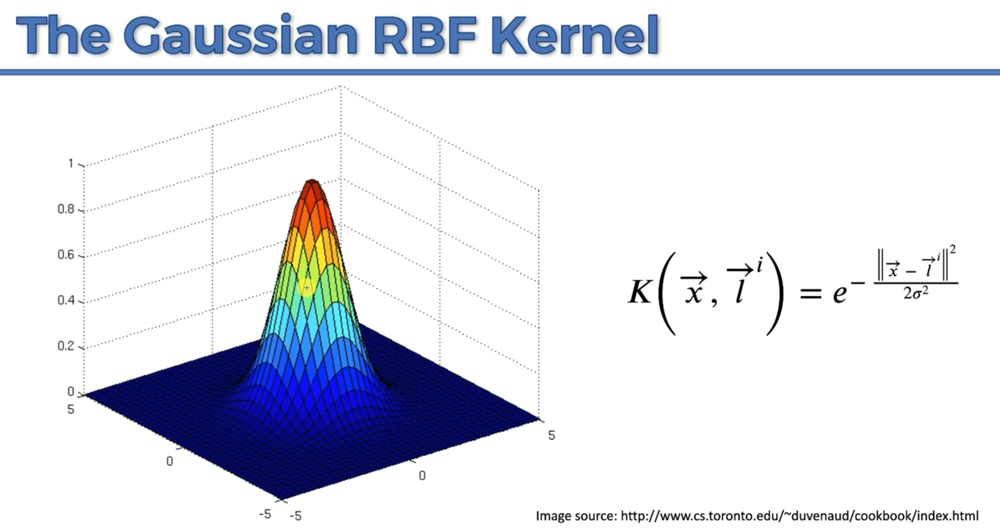

**Key difference from other regression models:** SVR requires feature scaling because the algorithm relies on distances and does not internally normalize features like `LinearRegression` does.

### Sample Dataset

This uses the same Position Salaries dataset from Polynomial Regression.

```csv
Position,Level,Salary
Business Analyst,1,45000
Junior Consultant,2,50000
Senior Consultant,3,60000
Manager,4,80000
Country Manager,5,110000
Region Manager,6,150000
Partner,7,200000
Senior Partner,8,300000
C-level,9,500000
CEO,10,1000000
```

### Importing Libraries

```python
import numpy as np
import matplotlib.pyplot as plt
import pandas as pd
```

### Importing the Dataset

```python
dataset = pd.read_csv('Position_Salaries.csv')
X = dataset.iloc[:, 1:-1].values
y = dataset.iloc[:, -1].values
```

```python
print(X)
```

```text
[[ 1]
 [ 2]
 [ 3]
 [ 4]
 [ 5]
 [ 6]
 [ 7]
 [ 8]
 [ 9]
 [10]]
```

```python
print(y)
```

```text
[  45000   50000   60000   80000  110000  150000  200000  300000  500000
 1000000]
```

`y` needs to be reshaped into a 2D array because `StandardScaler` expects a 2D input.

```python
y = y.reshape(len(y),1)
```

```python
print(y)
```

```text
[[  45000]
 [  50000]
 [  60000]
 [  80000]
 [ 110000]
 [ 150000]
 [ 200000]
 [ 300000]
 [ 500000]
 [1000000]]
```

### Feature Scaling

SVR does not have built-in feature scaling like `LinearRegression`. Because SVR uses distances to define the epsilon-insensitive tube, features with larger magnitudes would dominate the model. Both `X` and `y` must be scaled independently using separate `StandardScaler` instances.

```python
from sklearn.preprocessing import StandardScaler
sc_X = StandardScaler()
sc_y = StandardScaler()
X = sc_X.fit_transform(X)
y = sc_y.fit_transform(y)
```

Two separate scalers are needed because `X` and `y` have different distributions and scales. Each scaler computes its own mean ($\mu$) and standard deviation ($\sigma$) independently.

```python
print(X)
```

```text
[[-1.5666989 ]
 [-1.21854359]
 [-0.87038828]
 [-0.52223297]
 [-0.17407766]
 [ 0.17407766]
 [ 0.52223297]
 [ 0.87038828]
 [ 1.21854359]
 [ 1.5666989 ]]
```

```python
print(y)
```

```text
[[-0.72004253]
 [-0.70243757]
 [-0.66722767]
 [-0.59680786]
 [-0.49117815]
 [-0.35033854]
 [-0.17428902]
 [ 0.17781001]
 [ 0.88200808]
 [ 2.64250325]]
```

### Training the SVR Model

```python
from sklearn.svm import SVR
regressor = SVR(kernel = 'rbf')
regressor.fit(X, y)
```

`SVR(kernel='rbf')` creates a Support Vector Regression model with the Radial Basis Function (Gaussian) kernel. The RBF kernel is the most common choice for non-linear relationships. `fit(X, y)` trains the model on the scaled data. The entire dataset is used (no train-test split) because there are only 10 data points.

**Important `SVR` parameters:**

| Parameter | Purpose                                                                                                               |
| --------- | --------------------------------------------------------------------------------------------------------------------- |
| `kernel`  | Kernel type: `'linear'`, `'poly'`, `'rbf'` (default), `'sigmoid'`                                                     |
| `C`       | Regularization parameter (default `1.0`). Higher values reduce underfitting but risk overfitting                      |
| `epsilon` | Width of the epsilon-insensitive tube (default `0.1`). Points within this margin contribute no loss                   |
| `degree`  | Degree of the polynomial kernel (default `3`). Only used when `kernel='poly'`                                         |
| `gamma`   | Kernel coefficient for `'rbf'`, `'poly'`, and `'sigmoid'`. `'scale'` (default) uses $\frac{1}{n \cdot \text{Var}(X)}$ |

### Predicting a New Result

```python
sc_y.inverse_transform(regressor.predict(sc_X.transform([[6.5]])).reshape(-1,1))
```

```text
array([[170370.0204065]])
```

Because the model was trained on scaled data, new inputs must be scaled with `sc_X.transform()` before prediction, and the output must be inverse-transformed with `sc_y.inverse_transform()` to get the result back in the original salary scale. `reshape(-1, 1)` converts the 1D prediction into a 2D array as required by `inverse_transform()`. The model predicts a salary of approximately $170,370 for level 6.5.

### Visualising the SVR Results

```python
plt.scatter(sc_X.inverse_transform(X), sc_y.inverse_transform(y), color = 'red')
plt.plot(sc_X.inverse_transform(X), sc_y.inverse_transform(regressor.predict(X).reshape(-1,1)), color = 'blue')
plt.title('Truth or Bluff (SVR)')
plt.xlabel('Position level')
plt.ylabel('Salary')
plt.show()
```

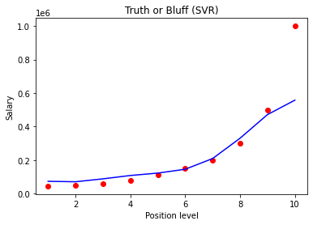

`sc_X.inverse_transform(X)` and `sc_y.inverse_transform(y)` convert the scaled values back to original scale for plotting. The red dots are actual salaries and the blue line is the SVR prediction. Notice that SVR does not capture the CEO salary (level 10) well — this is because the CEO salary is an outlier that falls far outside the epsilon-insensitive tube.

### Visualising the SVR Results (Higher Resolution)

```python
X_grid = np.arange(min(sc_X.inverse_transform(X)), max(sc_X.inverse_transform(X)), 0.1)
X_grid = X_grid.reshape((len(X_grid), 1))
plt.scatter(sc_X.inverse_transform(X), sc_y.inverse_transform(y), color = 'red')
plt.plot(X_grid, sc_y.inverse_transform(regressor.predict(sc_X.transform(X_grid)).reshape(-1,1)), color = 'blue')
plt.title('Truth or Bluff (SVR)')
plt.xlabel('Position level')
plt.ylabel('Salary')
plt.show()
```

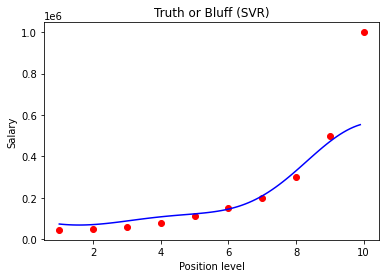

`np.arange(..., 0.1)` creates a finer grid of X values for a smoother curve. The grid values are in the original scale, so they must be transformed with `sc_X.transform(X_grid)` before prediction, and the predictions are inverse-transformed with `sc_y.inverse_transform()` for display. This reveals the smooth non-linear curve that SVR fits to the data, clearly showing how it handles the non-linear salary progression while treating the CEO salary as an outlier.

---

## Decision Tree Regression

Decision Tree Regression splits the data into regions by learning decision rules from the features, then predicts the average of the target values within each region. Unlike linear models, it can capture non-linear relationships without requiring polynomial features or feature scaling.

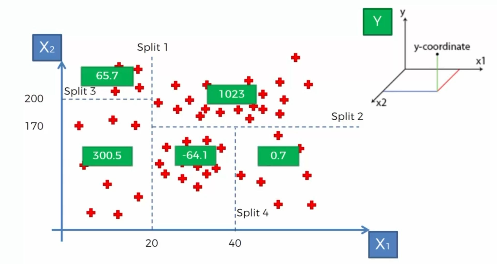

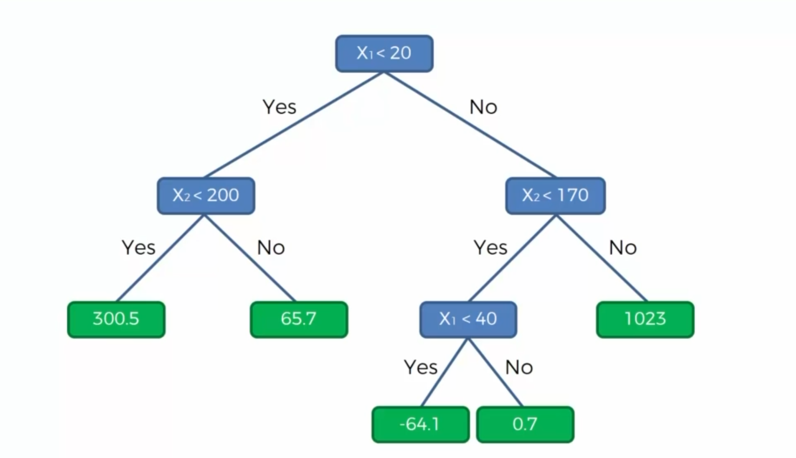

The tree recursively partitions the feature space into smaller regions. At each split, it chooses the feature and threshold that minimizes the variance (or another criterion) within the resulting subsets. Each terminal leaf node stores the average of the target values that fall into that region, and predictions are made by traversing the tree to the appropriate leaf.

### Sample Dataset

This uses the same Position Salaries dataset from Polynomial Regression and SVR.

```csv
Position,Level,Salary
Business Analyst,1,45000
Junior Consultant,2,50000
Senior Consultant,3,60000
Manager,4,80000
Country Manager,5,110000
Region Manager,6,150000
Partner,7,200000
Senior Partner,8,300000
C-level,9,500000
CEO,10,1000000
```

### Importing Libraries

```python
import numpy as np
import matplotlib.pyplot as plt
import pandas as pd
```

### Importing the Dataset

```python
dataset = pd.read_csv('Position_Salaries.csv')
X = dataset.iloc[:, 1:-1].values
y = dataset.iloc[:, -1].values
```

### Training the Decision Tree Regression Model

```python
from sklearn.tree import DecisionTreeRegressor
regressor = DecisionTreeRegressor(random_state = 0)
regressor.fit(X, y)
```

`DecisionTreeRegressor` builds a regression tree by recursively splitting the data. `random_state=0` fixes the seed for reproducibility when there are ties in split quality. `fit(X, y)` trains the tree on the entire dataset (no train-test split because there are only 10 data points). Feature scaling is not required because decision trees make splits based on thresholds, not distances.

**Important `DecisionTreeRegressor` parameters:**

| Parameter           | Purpose                                                                                                              |
| ------------------- | -------------------------------------------------------------------------------------------------------------------- |
| `criterion`         | Function to measure split quality: `'squared_error'` (default), `'friedman_mse'`, `'absolute_error'`, `'poisson'`    |
| `max_depth`         | Maximum depth of the tree. `None` (default) expands until all leaves are pure or contain `min_samples_split` samples |
| `min_samples_split` | Minimum samples required to split a node (default `2`)                                                               |
| `min_samples_leaf`  | Minimum samples required in a leaf node (default `1`)                                                                |
| `max_features`      | Number of features to consider for each split. `None` (default) uses all features                                    |
| `random_state`      | Seed for reproducibility                                                                                             |

`max_depth`, `min_samples_split`, and `min_samples_leaf` are the primary hyperparameters for controlling overfitting. A deeper tree captures more detail but risks fitting noise.

### Predicting a New Result

```python
regressor.predict([[6.5]])
```

```text
array([150000.])
```

The model predicts a salary of $150,000 for level 6.5. Because a decision tree predicts the average of the training values in each leaf, level 6.5 falls into the same leaf as level 6 (salary $150,000). Unlike polynomial regression or SVR, the prediction is always exactly one of the training set values — the tree cannot interpolate between data points.

### Visualising the Decision Tree Regression Results (Higher Resolution)

```python
X_grid = np.arange(min(X), max(X), 0.01)
X_grid = X_grid.reshape((len(X_grid), 1))
plt.scatter(X, y, color = 'red')
plt.plot(X_grid, regressor.predict(X_grid), color = 'blue')
plt.title('Truth or Bluff (Decision Tree Regression)')
plt.xlabel('Position level')
plt.ylabel('Salary')
plt.show()
```

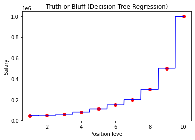

`np.arange(min(X), max(X), 0.01)` creates a fine grid to reveal the staircase pattern characteristic of decision trees. Each horizontal step represents a leaf node that predicts a constant value for all inputs in that region. The high-resolution grid is essential here — using only the original X values would plot a misleading smooth-looking line through the step centers.

---

## Random Forest Regression

Random Forest Regression is an ensemble learning method that combines multiple decision trees to produce a more robust and accurate prediction. Each tree is trained on a random subset of the data (with replacement), and the final prediction is the average of all individual tree predictions. This approach reduces overfitting compared to a single decision tree.

**Working of Ensemble Learning - Random Forest**

1. Pick a random K data points from the training set (bootstrap sampling).
2. Build a decision tree on these K data points.
3. Repeat steps 1-2 for N trees (controlled by `n_estimators`).
4. For a new data point, each tree makes a prediction and the final result is the average of all N predictions.

This process of training multiple models on random subsets and averaging their predictions is called **bagging** (Bootstrap Aggregating). By combining many trees, the random forest reduces variance without substantially increasing bias.

### Sample Dataset

This uses the same Position Salaries dataset.

```csv
Position,Level,Salary
Business Analyst,1,45000
Junior Consultant,2,50000
Senior Consultant,3,60000
Manager,4,80000
Country Manager,5,110000
Region Manager,6,150000
Partner,7,200000
Senior Partner,8,300000
C-level,9,500000
CEO,10,1000000
```

### Importing Libraries

```python
import numpy as np
import matplotlib.pyplot as plt
import pandas as pd
```

### Importing the Dataset

```python
dataset = pd.read_csv('Position_Salaries.csv')
X = dataset.iloc[:, 1:-1].values
y = dataset.iloc[:, -1].values
```

### Training the Random Forest Regression Model

```python
from sklearn.ensemble import RandomForestRegressor
regressor = RandomForestRegressor(n_estimators = 10, random_state = 0)
regressor.fit(X, y)
```

`RandomForestRegressor` creates an ensemble of decision trees. `n_estimators=10` specifies the number of trees in the forest. `random_state=0` fixes the seed for reproducibility. `fit(X, y)` trains all 10 trees on the entire dataset. Like individual decision trees, random forests do not require feature scaling.

**Important `RandomForestRegressor` parameters:**

| Parameter           | Purpose                                                                                                          |
| ------------------- | ---------------------------------------------------------------------------------------------------------------- |
| `n_estimators`      | Number of trees in the forest (default `100`). More trees generally improve performance but increase computation |
| `criterion`         | Split quality function: `'squared_error'` (default), `'absolute_error'`, `'friedman_mse'`, `'poisson'`           |
| `max_depth`         | Maximum depth of each tree. `None` (default) expands fully                                                       |
| `min_samples_split` | Minimum samples required to split a node (default `2`)                                                           |
| `min_samples_leaf`  | Minimum samples required in a leaf node (default `1`)                                                            |
| `max_features`      | Features to consider per split: `1.0` (default, all features), `'sqrt'`, `'log2'`, or a fraction                 |
| `bootstrap`         | `True` (default) uses bootstrap sampling. `False` uses the whole dataset for each tree                           |
| `n_jobs`            | Number of CPU cores for parallel training. `-1` uses all cores                                                   |
| `random_state`      | Seed for reproducibility                                                                                         |
| `oob_score`         | `False` (default). If `True`, uses out-of-bag samples to estimate generalization score                           |

`n_estimators` is the most important hyperparameter — increasing it generally improves accuracy up to a point of diminishing returns. `max_features` controls the randomness of each tree; using fewer features per split increases diversity among trees, which often improves ensemble performance.

### Predicting a New Result

```python
regressor.predict([[6.5]])
```

```text
array([167000.])
```

The model predicts a salary of $167,000 for level 6.5. This is the average prediction across all 10 trees. Unlike the single decision tree which predicted exactly $150,000 (the salary at level 6), the random forest produces a more nuanced prediction because different trees, trained on different subsets, may split the data differently around level 6.5.

### Visualising the Random Forest Regression Results (Higher Resolution)

```python
X_grid = np.arange(min(X), max(X), 0.01)
X_grid = X_grid.reshape((len(X_grid), 1))
plt.scatter(X, y, color = 'red')
plt.plot(X_grid, regressor.predict(X_grid), color = 'blue')
plt.title('Truth or Bluff (Random Forest Regression)')
plt.xlabel('Position level')
plt.ylabel('Salary')
plt.show()
```

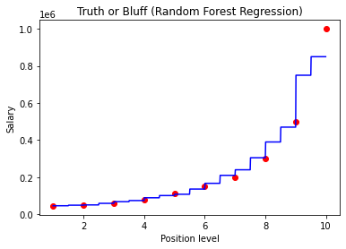

The plot shows a staircase pattern similar to a single decision tree, but with more steps. Each step represents the average prediction across the 10 trees. The additional steps arise because different trees split at different thresholds, and averaging their predictions creates intermediate levels. With more trees (`n_estimators`), the steps become finer and the prediction surface becomes smoother.


---

## Logistic Regression

Classification models predict a categorical label (a class) rather than a continuous value. Logistic Regression is a linear classification algorithm that predicts the probability of a binary outcome using the sigmoid function.

**Sigmoid Function:**

$$\hat{p} = \sigma(z) = \frac{1}{1 + e^{-z}}$$

Where $z = b_0 + b_1 X_1 + b_2 X_2 + \dots + b_n X_n$ is the linear combination of features. The sigmoid squashes any real-valued input into the range (0, 1), which can be interpreted as a probability. If $\hat{p} \geq 0.5$, the model predicts class 1; otherwise, class 0.

**Key idea:** Despite the name "regression," Logistic Regression is a classification algorithm. The "regression" part refers to the linear equation inside the sigmoid. The model learns the decision boundary — a line (or hyperplane in higher dimensions) that separates the two classes.

### Sample Dataset

The Social Network Ads dataset predicts whether a user purchased a product based on their Age and Estimated Salary.

```csv
Age,EstimatedSalary,Purchased
19,19000,0
35,20000,0
26,43000,0
27,57000,0
19,76000,0
27,58000,0
27,84000,0
32,150000,1
25,33000,0
35,65000,0
...
```

Here, `Age` and `EstimatedSalary` are features (X). `Purchased` (0 or 1) is the dependent variable (y).

### Importing Libraries

```python
import numpy as np
import matplotlib.pyplot as plt
import pandas as pd
```

### Importing the Dataset

```python
dataset = pd.read_csv('Social_Network_Ads.csv')
X = dataset.iloc[:, :-1].values
y = dataset.iloc[:, -1].values
```

### Splitting the Dataset

```python
from sklearn.model_selection import train_test_split
X_train, X_test, y_train, y_test = train_test_split(X, y, test_size = 0.25, random_state = 0)
```

`test_size=0.25` allocates 25% of the data to the test set and the remaining 75% to training.

### Feature Scaling

```python
from sklearn.preprocessing import StandardScaler
sc = StandardScaler()
X_train = sc.fit_transform(X_train)
X_test = sc.transform(X_test)
```

Feature scaling is essential for Logistic Regression because the algorithm uses gradient-based optimization. Features with larger magnitudes (e.g., Salary: 15000-150000) would dominate over smaller ones (e.g., Age: 18-60), causing slow convergence and poor performance. `fit_transform()` computes the mean and standard deviation from the training set and applies the transformation. `transform()` applies the same training-set parameters to the test set without refitting.

### Training the Model

```python
from sklearn.linear_model import LogisticRegression
classifier = LogisticRegression(random_state = 0)
classifier.fit(X_train, y_train)
```

`LogisticRegression()` creates a logistic regression classifier. `random_state=0` ensures reproducibility when the solver uses randomization. `fit(X_train, y_train)` trains the model by finding the optimal coefficients that maximize the likelihood of the observed data.

**Important `LogisticRegression` parameters:**

| Parameter      | Purpose                                                                                                     |
| -------------- | ----------------------------------------------------------------------------------------------------------- |
| `penalty`      | Regularization type: `'l2'` (default), `'l1'`, `'elasticnet'`, `'none'`                                    |
| `C`            | Inverse of regularization strength (default `1.0`). Smaller values = stronger regularization               |
| `solver`       | Optimization algorithm: `'lbfgs'` (default), `'liblinear'`, `'newton-cg'`, `'sag'`, `'saga'`               |
| `max_iter`     | Maximum iterations for the solver (default `100`). Increase if the model does not converge                  |
| `multi_class`  | `'auto'` (default), `'ovr'` (one-vs-rest), `'multinomial'`                                                 |
| `class_weight` | `None` (default) or `'balanced'` to handle imbalanced classes by adjusting weights inversely to frequencies |
| `random_state` | Seed for reproducibility                                                                                    |

`C` is the most important hyperparameter. A high `C` value means less regularization (more complex model, risk of overfitting). A low `C` value means more regularization (simpler model, risk of underfitting). `solver='liblinear'` is best for small datasets, while `'lbfgs'` or `'saga'` are better for large ones.

### Predicting a New Result

```python
print(classifier.predict(sc.transform([[30,87000]])))
```

```text
[0]
```

The model predicts that a 30-year-old with a salary of \$87,000 will not purchase (class 0). The input must be scaled with `sc.transform()` because the model was trained on scaled data.

### Predicting the Test Set Results

```python
y_pred = classifier.predict(X_test)
print(np.concatenate((y_pred.reshape(len(y_pred),1), y_test.reshape(len(y_test),1)),1))
```

`predict(X_test)` returns the predicted class for each test sample. The `np.concatenate` with `reshape` displays predictions alongside actual values for easy comparison. The left column is the predicted value and the right column is the actual value.

### Making the Confusion Matrix

```python
from sklearn.metrics import confusion_matrix, accuracy_score
cm = confusion_matrix(y_test, y_pred)
print(cm)
accuracy_score(y_test, y_pred)
```

```text
[[65  3]
 [ 8 24]]
```

```text
0.89
```

The confusion matrix shows: 65 true negatives (correctly predicted 0), 24 true positives (correctly predicted 1), 3 false positives (predicted 1 but was 0), and 8 false negatives (predicted 0 but was 1). The accuracy is 89%.

**Confusion Matrix Layout:**

|                    | Predicted 0 | Predicted 1 |
| ------------------ | ----------- | ----------- |
| **Actual 0**       | TN          | FP          |
| **Actual 1**       | FN          | TP          |

- **Accuracy** = (TN + TP) / Total = correct predictions / all predictions
- **Precision** = TP / (TP + FP) = of those predicted positive, how many were actually positive
- **Recall** = TP / (TP + FN) = of those actually positive, how many were correctly identified
- **F1-Score** = 2 × (Precision × Recall) / (Precision + Recall) = harmonic mean of precision and recall

### Visualising the Training Set Results

```python
from matplotlib.colors import ListedColormap
X_set, y_set = sc.inverse_transform(X_train), y_train
X1, X2 = np.meshgrid(np.arange(start = X_set[:, 0].min() - 10, stop = X_set[:, 0].max() + 10, step = 0.25),
                     np.arange(start = X_set[:, 1].min() - 1000, stop = X_set[:, 1].max() + 1000, step = 0.25))
plt.contourf(X1, X2, classifier.predict(sc.transform(np.array([X1.ravel(), X2.ravel()]).T)).reshape(X1.shape),
             alpha = 0.75, cmap = ListedColormap(('red', 'green')))
plt.xlim(X1.min(), X1.max())
plt.ylim(X2.min(), X2.max())
for i, j in enumerate(np.unique(y_set)):
    plt.scatter(X_set[y_set == j, 0], X_set[y_set == j, 1], c = ListedColormap(('red', 'green'))(i), label = j)
plt.title('Logistic Regression (Training set)')
plt.xlabel('Age')
plt.ylabel('Estimated Salary')
plt.legend()
plt.show()
```

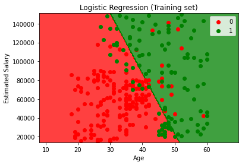

`sc.inverse_transform(X_train)` converts scaled values back to original scale for interpretable axes. `np.meshgrid` creates a grid covering the entire feature space. `classifier.predict()` classifies every point on this grid, and `plt.contourf` fills the regions with red (class 0) and green (class 1), revealing the decision boundary. The scatter points show actual training data. A straight decision boundary confirms that Logistic Regression is a linear classifier.

### Visualising the Test Set Results

```python
from matplotlib.colors import ListedColormap
X_set, y_set = sc.inverse_transform(X_test), y_test
X1, X2 = np.meshgrid(np.arange(start = X_set[:, 0].min() - 10, stop = X_set[:, 0].max() + 10, step = 0.25),
                     np.arange(start = X_set[:, 1].min() - 1000, stop = X_set[:, 1].max() + 1000, step = 0.25))
plt.contourf(X1, X2, classifier.predict(sc.transform(np.array([X1.ravel(), X2.ravel()]).T)).reshape(X1.shape),
             alpha = 0.75, cmap = ListedColormap(('red', 'green')))
plt.xlim(X1.min(), X1.max())
plt.ylim(X2.min(), X2.max())
for i, j in enumerate(np.unique(y_set)):
    plt.scatter(X_set[y_set == j, 0], X_set[y_set == j, 1], c = ListedColormap(('red', 'green'))(i), label = j)
plt.title('Logistic Regression (Test set)')
plt.xlabel('Age')
plt.ylabel('Estimated Salary')
plt.legend()
plt.show()
```

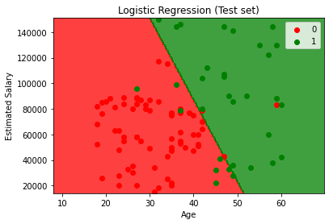

The decision boundary is the same as in the training set (it was learned during training). The test set points that fall on the wrong side of the boundary are the misclassifications.

---

## K-Nearest Neighbors (K-NN)

K-Nearest Neighbors is a non-parametric classification algorithm that classifies a new data point based on the majority class of its K nearest neighbors. It makes no assumptions about the underlying data distribution and does not learn an explicit model during training — the entire training set is stored and used at prediction time.

**How K-NN works:**

1. Choose the number of neighbors K (e.g., K = 5).
2. For a new data point, calculate the distance (e.g., Euclidean) to every training point.
3. Select the K nearest training points.
4. The new point is assigned to the class that is most common among these K neighbors (majority vote).

**Euclidean Distance:**

$$d(p, q) = \sqrt{\sum_{i=1}^{n}(p_i - q_i)^2}$$

### Sample Dataset

This uses the same Social Network Ads dataset.

### Importing Libraries

```python
import numpy as np
import matplotlib.pyplot as plt
import pandas as pd
```

### Importing the Dataset

```python
dataset = pd.read_csv('Social_Network_Ads.csv')
X = dataset.iloc[:, :-1].values
y = dataset.iloc[:, -1].values
```

### Splitting the Dataset

```python
from sklearn.model_selection import train_test_split
X_train, X_test, y_train, y_test = train_test_split(X, y, test_size = 0.25, random_state = 0)
```

### Feature Scaling

```python
from sklearn.preprocessing import StandardScaler
sc = StandardScaler()
X_train = sc.fit_transform(X_train)
X_test = sc.transform(X_test)
```

Feature scaling is critical for K-NN because the algorithm relies on distance calculations. Without scaling, features with larger ranges (e.g., Salary) would dominate the distance computation, making Age nearly irrelevant.

### Training the Model

```python
from sklearn.neighbors import KNeighborsClassifier
classifier = KNeighborsClassifier(n_neighbors = 5, metric = 'minkowski', p = 2)
classifier.fit(X_train, y_train)
```

`KNeighborsClassifier` creates a K-NN classifier. `n_neighbors=5` sets K to 5 (the default). `metric='minkowski'` with `p=2` uses Euclidean distance ($\sqrt{\sum(p_i - q_i)^2}$). With `p=1`, it would use Manhattan distance ($\sum|p_i - q_i|$). `fit()` simply stores the training data — no actual training occurs.

**Important `KNeighborsClassifier` parameters:**

| Parameter     | Purpose                                                                                              |
| ------------- | ---------------------------------------------------------------------------------------------------- |
| `n_neighbors` | Number of neighbors K (default `5`). Odd values prevent ties in binary classification               |
| `weights`     | `'uniform'` (default) gives equal weight to all neighbors. `'distance'` weights closer neighbors more |
| `metric`      | Distance metric: `'minkowski'` (default), `'euclidean'`, `'manhattan'`, `'chebyshev'`                |
| `p`           | Power parameter for Minkowski: `2` (default) = Euclidean, `1` = Manhattan                           |
| `algorithm`   | Algorithm for finding neighbors: `'auto'` (default), `'ball_tree'`, `'kd_tree'`, `'brute'`           |
| `n_jobs`      | Number of CPU cores for parallel computation. `-1` uses all cores                                    |

Choosing K is important: too small (e.g., K = 1) makes the model sensitive to noise and overfits; too large makes it too generalized and underfits. A common starting point is $K = \sqrt{n}$ where n is the number of training samples, rounded to the nearest odd number.

### Predicting a New Result

```python
print(classifier.predict(sc.transform([[30,87000]])))
```

```text
[0]
```

### Making the Confusion Matrix

```python
from sklearn.metrics import confusion_matrix, accuracy_score
cm = confusion_matrix(y_test, y_pred)
print(cm)
accuracy_score(y_test, y_pred)
```

```text
[[64  4]
 [ 3 29]]
```

```text
0.93
```

K-NN achieves 93% accuracy on this dataset, outperforming Logistic Regression (89%). The non-linear decision boundary of K-NN captures the data pattern better.

### Visualising the Training Set Results

```python
from matplotlib.colors import ListedColormap
X_set, y_set = sc.inverse_transform(X_train), y_train
X1, X2 = np.meshgrid(np.arange(start = X_set[:, 0].min() - 10, stop = X_set[:, 0].max() + 10, step = 1),
                     np.arange(start = X_set[:, 1].min() - 1000, stop = X_set[:, 1].max() + 1000, step = 1))
plt.contourf(X1, X2, classifier.predict(sc.transform(np.array([X1.ravel(), X2.ravel()]).T)).reshape(X1.shape),
             alpha = 0.75, cmap = ListedColormap(('red', 'green')))
plt.xlim(X1.min(), X1.max())
plt.ylim(X2.min(), X2.max())
for i, j in enumerate(np.unique(y_set)):
    plt.scatter(X_set[y_set == j, 0], X_set[y_set == j, 1], c = ListedColormap(('red', 'green'))(i), label = j)
plt.title('K-NN (Training set)')
plt.xlabel('Age')
plt.ylabel('Estimated Salary')
plt.legend()
plt.show()
```

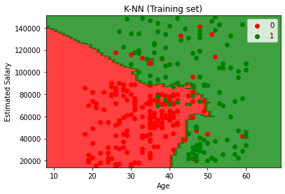

Unlike Logistic Regression's straight line, K-NN produces an irregular, non-linear decision boundary that closely follows the data. The boundary has a "jagged" appearance because each region is determined by the local neighborhood of points.

### Visualising the Test Set Results

```python
from matplotlib.colors import ListedColormap
X_set, y_set = sc.inverse_transform(X_test), y_test
X1, X2 = np.meshgrid(np.arange(start = X_set[:, 0].min() - 10, stop = X_set[:, 0].max() + 10, step = 1),
                     np.arange(start = X_set[:, 1].min() - 1000, stop = X_set[:, 1].max() + 1000, step = 1))
plt.contourf(X1, X2, classifier.predict(sc.transform(np.array([X1.ravel(), X2.ravel()]).T)).reshape(X1.shape),
             alpha = 0.75, cmap = ListedColormap(('red', 'green')))
plt.xlim(X1.min(), X1.max())
plt.ylim(X2.min(), X2.max())
for i, j in enumerate(np.unique(y_set)):
    plt.scatter(X_set[y_set == j, 0], X_set[y_set == j, 1], c = ListedColormap(('red', 'green'))(i), label = j)
plt.title('K-NN (Test set)')
plt.xlabel('Age')
plt.ylabel('Estimated Salary')
plt.legend()
plt.show()
```

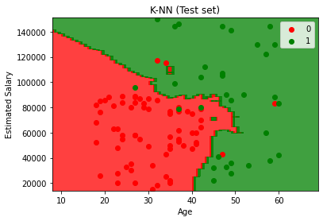

---

## Support Vector Machine (SVM)

Support Vector Machine finds the optimal hyperplane that separates two classes with the maximum margin. The margin is the distance between the hyperplane and the nearest data points from each class. These nearest points are called **support vectors** — they "support" the position of the hyperplane.

**Key concepts:**

- **Maximum Margin Classifier:** SVM maximizes the distance between the decision boundary and the closest points from each class. A wider margin generally leads to better generalization.
- **Support Vectors:** The data points closest to the decision boundary. Only these points influence the position of the hyperplane; removing any other point would not change the result.
- **Linear Kernel:** The SVM finds a straight line (2D) or flat hyperplane (higher dimensions) to separate the classes.

### Sample Dataset

This uses the same Social Network Ads dataset.

### Importing Libraries

```python
import numpy as np
import matplotlib.pyplot as plt
import pandas as pd
```

### Importing the Dataset

```python
dataset = pd.read_csv('Social_Network_Ads.csv')
X = dataset.iloc[:, :-1].values
y = dataset.iloc[:, -1].values
```

### Splitting the Dataset

```python
from sklearn.model_selection import train_test_split
X_train, X_test, y_train, y_test = train_test_split(X, y, test_size = 0.25, random_state = 0)
```

### Feature Scaling

```python
from sklearn.preprocessing import StandardScaler
sc = StandardScaler()
X_train = sc.fit_transform(X_train)
X_test = sc.transform(X_test)
```

Feature scaling is essential for SVM because the algorithm relies on distances to compute the margin. Unscaled features would distort the margin calculation.

### Training the Model

```python
from sklearn.svm import SVC
classifier = SVC(kernel = 'linear', random_state = 0)
classifier.fit(X_train, y_train)
```

`SVC` (Support Vector Classifier) creates an SVM model. `kernel='linear'` specifies a linear decision boundary. `random_state=0` fixes the seed for reproducibility. `fit()` finds the optimal hyperplane by solving a constrained optimization problem.

**Important `SVC` parameters:**

| Parameter                  | Purpose                                                                                                              |
| -------------------------- | -------------------------------------------------------------------------------------------------------------------- |
| `kernel`                   | Kernel type: `'linear'`, `'poly'`, `'rbf'` (default), `'sigmoid'`                                                   |
| `C`                        | Regularization parameter (default `1.0`). Higher values reduce misclassification but risk overfitting               |
| `gamma`                    | Kernel coefficient for `'rbf'`, `'poly'`, `'sigmoid'`. `'scale'` (default) uses $\frac{1}{n \cdot \text{Var}(X)}$    |
| `degree`                   | Degree of the polynomial kernel (default `3`). Only used when `kernel='poly'`                                        |
| `class_weight`             | `None` (default) or `'balanced'` to handle imbalanced classes                                                        |
| `probability`              | `False` (default). Set `True` to enable probability estimates via `predict_proba()`                                  |
| `decision_function_shape`  | `'ovr'` (default, one-vs-rest) or `'ovo'` (one-vs-one) for multiclass                                               |

### Predicting a New Result

```python
print(classifier.predict(sc.transform([[30,87000]])))
```

```text
[0]
```

### Making the Confusion Matrix

```python
from sklearn.metrics import confusion_matrix, accuracy_score
cm = confusion_matrix(y_test, y_pred)
print(cm)
accuracy_score(y_test, y_pred)
```

```text
[[66  2]
 [ 8 24]]
```

```text
0.9
```

SVM with a linear kernel achieves 90% accuracy. It has fewer false positives (2) than Logistic Regression (3), but the same number of false negatives (8).

### Visualising the Training Set Results

```python
from matplotlib.colors import ListedColormap
X_set, y_set = sc.inverse_transform(X_train), y_train
X1, X2 = np.meshgrid(np.arange(start = X_set[:, 0].min() - 10, stop = X_set[:, 0].max() + 10, step = 0.25),
                     np.arange(start = X_set[:, 1].min() - 1000, stop = X_set[:, 1].max() + 1000, step = 0.25))
plt.contourf(X1, X2, classifier.predict(sc.transform(np.array([X1.ravel(), X2.ravel()]).T)).reshape(X1.shape),
             alpha = 0.75, cmap = ListedColormap(('red', 'green')))
plt.xlim(X1.min(), X1.max())
plt.ylim(X2.min(), X2.max())
for i, j in enumerate(np.unique(y_set)):
    plt.scatter(X_set[y_set == j, 0], X_set[y_set == j, 1], c = ListedColormap(('red', 'green'))(i), label = j)
plt.title('SVM (Training set)')
plt.xlabel('Age')
plt.ylabel('Estimated Salary')
plt.legend()
plt.show()
```

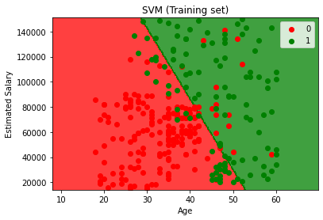

Like Logistic Regression, the linear SVM produces a straight decision boundary. However, the boundary position differs because SVM maximizes the margin while Logistic Regression maximizes the likelihood.

### Visualising the Test Set Results

```python
from matplotlib.colors import ListedColormap
X_set, y_set = sc.inverse_transform(X_test), y_test
X1, X2 = np.meshgrid(np.arange(start = X_set[:, 0].min() - 10, stop = X_set[:, 0].max() + 10, step = 0.25),
                     np.arange(start = X_set[:, 1].min() - 1000, stop = X_set[:, 1].max() + 1000, step = 0.25))
plt.contourf(X1, X2, classifier.predict(sc.transform(np.array([X1.ravel(), X2.ravel()]).T)).reshape(X1.shape),
             alpha = 0.75, cmap = ListedColormap(('red', 'green')))
plt.xlim(X1.min(), X1.max())
plt.ylim(X2.min(), X2.max())
for i, j in enumerate(np.unique(y_set)):
    plt.scatter(X_set[y_set == j, 0], X_set[y_set == j, 1], c = ListedColormap(('red', 'green'))(i), label = j)
plt.title('SVM (Test set)')
plt.xlabel('Age')
plt.ylabel('Estimated Salary')
plt.legend()
plt.show()
```

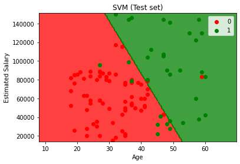

---

## Kernel SVM

Kernel SVM extends the standard SVM to handle non-linearly separable data. When classes cannot be separated by a straight line, a kernel function maps the data into a higher-dimensional space where a linear separation becomes possible. The decision boundary in the original space appears as a curve.

**The Kernel Trick:**

Instead of explicitly computing the transformation to higher dimensions (which would be computationally expensive), the kernel trick computes the dot product in the higher-dimensional space directly using a kernel function. This avoids the need to ever compute the actual coordinates in the higher-dimensional space.

**Common Kernel Functions:**

| Kernel       | Function                                                              | Use Case                                  |
| ------------ | --------------------------------------------------------------------- | ----------------------------------------- |
| Linear       | $K(x, y) = x^T y$                                                    | Linearly separable data                   |
| Polynomial   | $K(x, y) = (x^T y + c)^d$                                            | Data with polynomial relationships        |
| RBF/Gaussian | $K(x, y) = e^{-\gamma \|x - y\|^2}$                                  | Most common; works well for most problems |
| Sigmoid      | $K(x, y) = \tanh(\gamma x^T y + c)$                                  | Similar to neural network activation      |

The **RBF (Radial Basis Function)** kernel is the most widely used. It measures the similarity between two points based on their Euclidean distance. Points closer together have higher similarity. The $\gamma$ parameter controls how far the influence of a single training point reaches: higher $\gamma$ means closer influence (more complex boundary, risk of overfitting).

### Sample Dataset

This uses the same Social Network Ads dataset.

### Importing Libraries

```python
import numpy as np
import matplotlib.pyplot as plt
import pandas as pd
```

### Importing the Dataset

```python
dataset = pd.read_csv('Social_Network_Ads.csv')
X = dataset.iloc[:, :-1].values
y = dataset.iloc[:, -1].values
```

### Splitting the Dataset

```python
from sklearn.model_selection import train_test_split
X_train, X_test, y_train, y_test = train_test_split(X, y, test_size = 0.25, random_state = 0)
```

### Feature Scaling

```python
from sklearn.preprocessing import StandardScaler
sc = StandardScaler()
X_train = sc.fit_transform(X_train)
X_test = sc.transform(X_test)
```

### Training the Model

```python
from sklearn.svm import SVC
classifier = SVC(kernel = 'rbf', random_state = 0)
classifier.fit(X_train, y_train)
```

`kernel='rbf'` specifies the Gaussian RBF kernel, which creates a non-linear decision boundary. This is the default kernel for `SVC`. The RBF kernel can model complex, non-linear patterns that linear classifiers cannot capture.

### Predicting a New Result

```python
print(classifier.predict(sc.transform([[30,87000]])))
```

```text
[0]
```

### Making the Confusion Matrix

```python
from sklearn.metrics import confusion_matrix, accuracy_score
cm = confusion_matrix(y_test, y_pred)
print(cm)
accuracy_score(y_test, y_pred)
```

```text
[[64  4]
 [ 3 29]]
```

```text
0.93
```

Kernel SVM with the RBF kernel achieves 93% accuracy — significantly better than the linear SVM (90%) and matching K-NN. The non-linear decision boundary captures the underlying pattern more effectively.

### Visualising the Training Set Results

```python
from matplotlib.colors import ListedColormap
X_set, y_set = sc.inverse_transform(X_train), y_train
X1, X2 = np.meshgrid(np.arange(start = X_set[:, 0].min() - 10, stop = X_set[:, 0].max() + 10, step = 0.25),
                     np.arange(start = X_set[:, 1].min() - 1000, stop = X_set[:, 1].max() + 1000, step = 0.25))
plt.contourf(X1, X2, classifier.predict(sc.transform(np.array([X1.ravel(), X2.ravel()]).T)).reshape(X1.shape),
             alpha = 0.75, cmap = ListedColormap(('red', 'green')))
plt.xlim(X1.min(), X1.max())
plt.ylim(X2.min(), X2.max())
for i, j in enumerate(np.unique(y_set)):
    plt.scatter(X_set[y_set == j, 0], X_set[y_set == j, 1], c = ListedColormap(('red', 'green'))(i), label = j)
plt.title('Kernel SVM (Training set)')
plt.xlabel('Age')
plt.ylabel('Estimated Salary')
plt.legend()
plt.show()
```

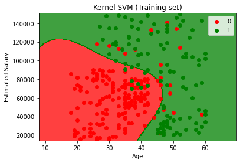

The decision boundary is now a smooth, non-linear curve that wraps around the green (purchased) region. Unlike K-NN's jagged boundary, Kernel SVM produces a smooth boundary because the RBF kernel creates a continuous mapping.

### Visualising the Test Set Results

```python
from matplotlib.colors import ListedColormap
X_set, y_set = sc.inverse_transform(X_test), y_test
X1, X2 = np.meshgrid(np.arange(start = X_set[:, 0].min() - 10, stop = X_set[:, 0].max() + 10, step = 0.25),
                     np.arange(start = X_set[:, 1].min() - 1000, stop = X_set[:, 1].max() + 1000, step = 0.25))
plt.contourf(X1, X2, classifier.predict(sc.transform(np.array([X1.ravel(), X2.ravel()]).T)).reshape(X1.shape),
             alpha = 0.75, cmap = ListedColormap(('red', 'green')))
plt.xlim(X1.min(), X1.max())
plt.ylim(X2.min(), X2.max())
for i, j in enumerate(np.unique(y_set)):
    plt.scatter(X_set[y_set == j, 0], X_set[y_set == j, 1], c = ListedColormap(('red', 'green'))(i), label = j)
plt.title('Kernel SVM (Test set)')
plt.xlabel('Age')
plt.ylabel('Estimated Salary')
plt.legend()
plt.show()
```

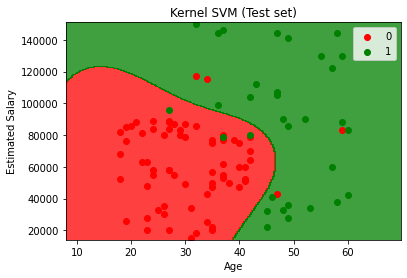

---

## Naive Bayes

Naive Bayes is a probabilistic classifier based on Bayes' Theorem with the "naive" assumption that all features are independent of each other given the class label. Despite this strong assumption rarely being true in practice, Naive Bayes often performs surprisingly well, especially on text classification and datasets with many features.

**Bayes' Theorem:**

$$P(A|B) = \frac{P(B|A) \cdot P(A)}{P(B)}$$

- $P(A|B)$: **Posterior probability** — the probability of class A given the observed features B
- $P(B|A)$: **Likelihood** — the probability of observing features B given class A
- $P(A)$: **Prior probability** — the overall probability of class A (before seeing the features)
- $P(B)$: **Marginal likelihood** — the overall probability of observing features B

For classification, the model computes $P(\text{class}|\text{features})$ for each class and predicts the class with the highest posterior probability.

**Why "Naive"?** The algorithm assumes that each feature contributes independently to the probability. For example, it assumes that Age and Salary are independent given the Purchased class. This simplification makes the computation tractable — instead of estimating the joint probability of all features, it multiplies the individual feature probabilities.

**Gaussian Naive Bayes** assumes that continuous features follow a Gaussian (normal) distribution within each class. The likelihood of each feature is computed using the Gaussian probability density function with the mean and variance estimated from the training data.

### Sample Dataset

This uses the same Social Network Ads dataset.

### Importing Libraries

```python
import numpy as np
import matplotlib.pyplot as plt
import pandas as pd
```

### Importing the Dataset

```python
dataset = pd.read_csv('Social_Network_Ads.csv')
X = dataset.iloc[:, :-1].values
y = dataset.iloc[:, -1].values
```

### Splitting the Dataset

```python
from sklearn.model_selection import train_test_split
X_train, X_test, y_train, y_test = train_test_split(X, y, test_size = 0.25, random_state = 0)
```

### Feature Scaling

```python
from sklearn.preprocessing import StandardScaler
sc = StandardScaler()
X_train = sc.fit_transform(X_train)
X_test = sc.transform(X_test)
```

While Naive Bayes does not strictly require feature scaling (it computes probabilities, not distances), scaling can improve numerical stability and is applied here for consistency with the visualization code.

### Training the Model

```python
from sklearn.naive_bayes import GaussianNB
classifier = GaussianNB()
classifier.fit(X_train, y_train)
```

`GaussianNB` creates a Gaussian Naive Bayes classifier. It has no hyperparameters to tune (no `random_state` needed). `fit()` computes the mean and variance of each feature for each class, along with the prior probability of each class.

**Important `GaussianNB` parameters:**

| Parameter        | Purpose                                                                                   |
| ---------------- | ----------------------------------------------------------------------------------------- |
| `priors`         | Prior probabilities of classes. `None` (default) computes them from the training data     |
| `var_smoothing`  | Portion of the largest variance added to all variances for stability (default `1e-9`)     |

**Other Naive Bayes variants in scikit-learn:**

| Variant            | Use Case                                                        |
| ------------------ | --------------------------------------------------------------- |
| `MultinomialNB`    | Text classification with word counts (e.g., TF-IDF features)   |
| `BernoulliNB`      | Binary features (e.g., word presence/absence)                   |
| `ComplementNB`     | Improved version of Multinomial for imbalanced text datasets    |
| `CategoricalNB`    | Categorical features                                            |

### Predicting a New Result

```python
print(classifier.predict(sc.transform([[30,87000]])))
```

```text
[0]
```

### Making the Confusion Matrix

```python
from sklearn.metrics import confusion_matrix, accuracy_score
cm = confusion_matrix(y_test, y_pred)
print(cm)
accuracy_score(y_test, y_pred)
```

```text
[[65  3]
 [ 7 25]]
```

```text
0.9
```

Naive Bayes achieves 90% accuracy. It performs comparably to the linear SVM and Logistic Regression, which is remarkable given its simplicity and the strong independence assumption. Naive Bayes is also very fast — training is essentially just computing means and variances.

### Visualising the Training Set Results

```python
from matplotlib.colors import ListedColormap
X_set, y_set = sc.inverse_transform(X_train), y_train
X1, X2 = np.meshgrid(np.arange(start = X_set[:, 0].min() - 10, stop = X_set[:, 0].max() + 10, step = 0.25),
                     np.arange(start = X_set[:, 1].min() - 1000, stop = X_set[:, 1].max() + 1000, step = 0.25))
plt.contourf(X1, X2, classifier.predict(sc.transform(np.array([X1.ravel(), X2.ravel()]).T)).reshape(X1.shape),
             alpha = 0.75, cmap = ListedColormap(('red', 'green')))
plt.xlim(X1.min(), X1.max())
plt.ylim(X2.min(), X2.max())
for i, j in enumerate(np.unique(y_set)):
    plt.scatter(X_set[y_set == j, 0], X_set[y_set == j, 1], c = ListedColormap(('red', 'green'))(i), label = j)
plt.title('Naive Bayes (Training set)')
plt.xlabel('Age')
plt.ylabel('Estimated Salary')
plt.legend()
plt.show()
```

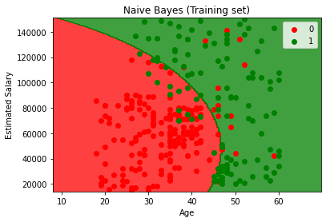

The decision boundary is a smooth curve, not a straight line. Even though Naive Bayes computes probabilities independently for each feature, the combined effect of the Gaussian distributions creates an elliptical boundary that separates the classes non-linearly.

### Visualising the Test Set Results

```python
from matplotlib.colors import ListedColormap
X_set, y_set = sc.inverse_transform(X_test), y_test
X1, X2 = np.meshgrid(np.arange(start = X_set[:, 0].min() - 10, stop = X_set[:, 0].max() + 10, step = 0.25),
                     np.arange(start = X_set[:, 1].min() - 1000, stop = X_set[:, 1].max() + 1000, step = 0.25))
plt.contourf(X1, X2, classifier.predict(sc.transform(np.array([X1.ravel(), X2.ravel()]).T)).reshape(X1.shape),
             alpha = 0.75, cmap = ListedColormap(('red', 'green')))
plt.xlim(X1.min(), X1.max())
plt.ylim(X2.min(), X2.max())
for i, j in enumerate(np.unique(y_set)):
    plt.scatter(X_set[y_set == j, 0], X_set[y_set == j, 1], c = ListedColormap(('red', 'green'))(i), label = j)
plt.title('Naive Bayes (Test set)')
plt.xlabel('Age')
plt.ylabel('Estimated Salary')
plt.legend()
plt.show()
```

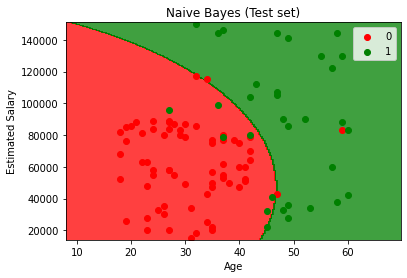

---

## Decision Tree Classification

Decision Tree Classification works the same way as Decision Tree Regression (covered earlier), but instead of predicting a continuous value, it predicts a class label. The tree recursively splits the feature space into regions and assigns the majority class in each region.

**How it works:**

1. At each node, the algorithm selects the feature and threshold that best separates the classes.
2. "Best" is measured by a criterion: **Gini Impurity** or **Information Gain (Entropy)**.
3. The process repeats until a stopping condition is met (e.g., maximum depth, minimum samples in a leaf).
4. Each leaf node predicts the majority class of the training samples that fall into it.

**Entropy:**

$$H(S) = -\sum_{i=1}^{c} p_i \log_2(p_i)$$

Where $p_i$ is the proportion of class $i$ in the set $S$, and $c$ is the number of classes. Entropy measures the disorder or impurity of a set. A pure set (all one class) has entropy 0. A maximally mixed set (equal proportions) has maximum entropy.

**Information Gain:**

$$IG = H(\text{parent}) - \sum \frac{|S_{\text{child}}|}{|S_{\text{parent}}|} H(S_{\text{child}})$$

The split that maximizes Information Gain (or equivalently, reduces entropy the most) is chosen at each node.

### Sample Dataset

This uses the same Social Network Ads dataset.

### Importing Libraries

```python
import numpy as np
import matplotlib.pyplot as plt
import pandas as pd
```

### Importing the Dataset

```python
dataset = pd.read_csv('Social_Network_Ads.csv')
X = dataset.iloc[:, :-1].values
y = dataset.iloc[:, -1].values
```

### Splitting the Dataset

```python
from sklearn.model_selection import train_test_split
X_train, X_test, y_train, y_test = train_test_split(X, y, test_size = 0.25, random_state = 0)
```

### Feature Scaling

```python
from sklearn.preprocessing import StandardScaler
sc = StandardScaler()
X_train = sc.fit_transform(X_train)
X_test = sc.transform(X_test)
```

Decision trees do not require feature scaling because they make splits based on thresholds, not distances. However, scaling is applied here for the visualization code to work correctly (the meshgrid requires the same scaled space).

### Training the Model

```python
from sklearn.tree import DecisionTreeClassifier
classifier = DecisionTreeClassifier(criterion = 'entropy', random_state = 0)
classifier.fit(X_train, y_train)
```

`DecisionTreeClassifier` creates a classification tree. `criterion='entropy'` uses Information Gain to select the best split. The alternative is `'gini'` (default), which uses Gini Impurity. `random_state=0` ensures reproducibility. `fit()` builds the tree by recursively splitting the data.

**Important `DecisionTreeClassifier` parameters:**

| Parameter           | Purpose                                                                                                              |
| ------------------- | -------------------------------------------------------------------------------------------------------------------- |
| `criterion`         | Split quality function: `'gini'` (default) or `'entropy'`                                                           |
| `max_depth`         | Maximum depth of the tree. `None` (default) expands until all leaves are pure or contain `min_samples_split` samples |
| `min_samples_split` | Minimum samples required to split a node (default `2`)                                                               |
| `min_samples_leaf`  | Minimum samples required in a leaf node (default `1`)                                                                |
| `max_features`      | Number of features to consider for each split. `None` (default) uses all features                                    |
| `splitter`          | `'best'` (default) chooses the best split, `'random'` chooses the best random split                                  |
| `class_weight`      | `None` (default) or `'balanced'` to handle imbalanced classes                                                        |
| `random_state`      | Seed for reproducibility                                                                                             |

**Gini Impurity vs Entropy:** In practice, both produce very similar trees. Gini Impurity is slightly faster to compute (no logarithm). Use entropy when you want to maximize information gain explicitly.

### Predicting a New Result

```python
print(classifier.predict(sc.transform([[30,87000]])))
```

```text
[0]
```

### Making the Confusion Matrix

```python
from sklearn.metrics import confusion_matrix, accuracy_score
cm = confusion_matrix(y_test, y_pred)
print(cm)
accuracy_score(y_test, y_pred)
```

```text
[[62  6]
 [ 3 29]]
```

```text
0.91
```

Decision Tree Classification achieves 91% accuracy. It has fewer false negatives (3) but more false positives (6) compared to K-NN and Kernel SVM. Decision trees are prone to overfitting, especially when grown deep without pruning.

### Visualising the Training Set Results

```python
from matplotlib.colors import ListedColormap
X_set, y_set = sc.inverse_transform(X_train), y_train
X1, X2 = np.meshgrid(np.arange(start = X_set[:, 0].min() - 10, stop = X_set[:, 0].max() + 10, step = 0.25),
                     np.arange(start = X_set[:, 1].min() - 1000, stop = X_set[:, 1].max() + 1000, step = 0.25))
plt.contourf(X1, X2, classifier.predict(sc.transform(np.array([X1.ravel(), X2.ravel()]).T)).reshape(X1.shape),
             alpha = 0.75, cmap = ListedColormap(('red', 'green')))
plt.xlim(X1.min(), X1.max())
plt.ylim(X2.min(), X2.max())
for i, j in enumerate(np.unique(y_set)):
    plt.scatter(X_set[y_set == j, 0], X_set[y_set == j, 1], c = ListedColormap(('red', 'green'))(i), label = j)
plt.title('Decision Tree Classification (Training set)')
plt.xlabel('Age')
plt.ylabel('Estimated Salary')
plt.legend()
plt.show()
```

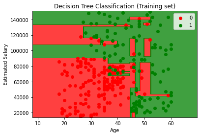

The decision boundary consists of axis-aligned rectangular regions — this is the characteristic shape of decision tree boundaries. Each rectangle corresponds to a leaf node. Notice the overfitting: there are small isolated green and red regions that capture individual training points rather than the general pattern.

### Visualising the Test Set Results

```python
from matplotlib.colors import ListedColormap
X_set, y_set = sc.inverse_transform(X_test), y_test
X1, X2 = np.meshgrid(np.arange(start = X_set[:, 0].min() - 10, stop = X_set[:, 0].max() + 10, step = 0.25),
                     np.arange(start = X_set[:, 1].min() - 1000, stop = X_set[:, 1].max() + 1000, step = 0.25))
plt.contourf(X1, X2, classifier.predict(sc.transform(np.array([X1.ravel(), X2.ravel()]).T)).reshape(X1.shape),
             alpha = 0.75, cmap = ListedColormap(('red', 'green')))
plt.xlim(X1.min(), X1.max())
plt.ylim(X2.min(), X2.max())
for i, j in enumerate(np.unique(y_set)):
    plt.scatter(X_set[y_set == j, 0], X_set[y_set == j, 1], c = ListedColormap(('red', 'green'))(i), label = j)
plt.title('Decision Tree Classification (Test set)')
plt.xlabel('Age')
plt.ylabel('Estimated Salary')
plt.legend()
plt.show()
```

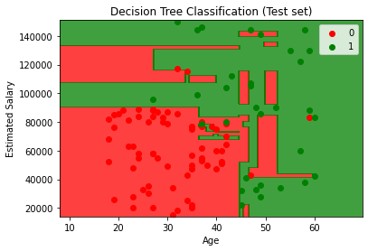

---

## Random Forest Classification

Random Forest Classification is an ensemble method that builds multiple decision trees and combines their predictions through majority voting. Each tree is trained on a random bootstrap sample of the data and considers a random subset of features at each split. This randomness reduces overfitting compared to a single decision tree.

**How it works:**

1. Create N bootstrap samples (random subsets with replacement) from the training data.
2. Build a decision tree on each sample, using a random subset of features at each split.
3. For a new data point, each tree votes for a class.
4. The final prediction is the class with the most votes (majority voting).

This process is called **bagging** (Bootstrap Aggregating), combined with random feature selection. The diversity among trees (from different samples and features) is what gives Random Forest its power — individual trees may overfit, but their errors tend to cancel out when averaged.

### Sample Dataset

This uses the same Social Network Ads dataset.

### Importing Libraries

```python
import numpy as np
import matplotlib.pyplot as plt
import pandas as pd
```

### Importing the Dataset

```python
dataset = pd.read_csv('Social_Network_Ads.csv')
X = dataset.iloc[:, :-1].values
y = dataset.iloc[:, -1].values
```

### Splitting the Dataset

```python
from sklearn.model_selection import train_test_split
X_train, X_test, y_train, y_test = train_test_split(X, y, test_size = 0.25, random_state = 0)
```

### Feature Scaling

```python
from sklearn.preprocessing import StandardScaler
sc = StandardScaler()
X_train = sc.fit_transform(X_train)
X_test = sc.transform(X_test)
```

Like single decision trees, random forests do not require feature scaling. Scaling is applied here for visualization purposes.

### Training the Model

```python
from sklearn.ensemble import RandomForestClassifier
classifier = RandomForestClassifier(n_estimators = 10, criterion = 'entropy', random_state = 0)
classifier.fit(X_train, y_train)
```

`RandomForestClassifier` creates an ensemble of decision trees. `n_estimators=10` specifies 10 trees in the forest. `criterion='entropy'` uses Information Gain for splitting (same as in Decision Tree Classification). `random_state=0` fixes the seed for reproducibility. `fit()` trains all 10 trees on bootstrap samples of the training data.

**Important `RandomForestClassifier` parameters:**

| Parameter           | Purpose                                                                                                          |
| ------------------- | ---------------------------------------------------------------------------------------------------------------- |
| `n_estimators`      | Number of trees in the forest (default `100`). More trees generally improve performance but increase computation |
| `criterion`         | Split quality function: `'gini'` (default) or `'entropy'`                                                       |
| `max_depth`         | Maximum depth of each tree. `None` (default) expands fully                                                       |
| `min_samples_split` | Minimum samples required to split a node (default `2`)                                                           |
| `min_samples_leaf`  | Minimum samples required in a leaf node (default `1`)                                                            |
| `max_features`      | Features per split: `'sqrt'` (default), `'log2'`, a fraction, or `None` (all features)                          |
| `bootstrap`         | `True` (default) uses bootstrap sampling. `False` uses the whole dataset for each tree                           |
| `n_jobs`            | Number of CPU cores for parallel training. `-1` uses all cores                                                   |
| `random_state`      | Seed for reproducibility                                                                                         |
| `oob_score`         | `False` (default). If `True`, uses out-of-bag samples to estimate generalization score                           |
| `class_weight`      | `None` (default) or `'balanced'` to handle imbalanced classes                                                    |

`n_estimators` is the most important hyperparameter — performance generally improves with more trees until diminishing returns. `max_features='sqrt'` (the default for classifiers) means each split considers $\sqrt{n_{\text{features}}}$ features, increasing diversity among trees. For this 2-feature dataset, it considers 1 feature per split.

### Predicting a New Result

```python
print(classifier.predict(sc.transform([[30,87000]])))
```

```text
[0]
```

### Making the Confusion Matrix

```python
from sklearn.metrics import confusion_matrix, accuracy_score
cm = confusion_matrix(y_test, y_pred)
print(cm)
accuracy_score(y_test, y_pred)
```

```text
[[63  5]
 [ 4 28]]
```

```text
0.91
```

Random Forest Classification achieves 91% accuracy, the same as the single Decision Tree on this dataset. With a larger dataset and more trees, the Random Forest would typically outperform the single tree due to reduced overfitting.

### Visualising the Training Set Results

```python
from matplotlib.colors import ListedColormap
X_set, y_set = sc.inverse_transform(X_train), y_train
X1, X2 = np.meshgrid(np.arange(start = X_set[:, 0].min() - 10, stop = X_set[:, 0].max() + 10, step = 0.25),
                     np.arange(start = X_set[:, 1].min() - 1000, stop = X_set[:, 1].max() + 1000, step = 0.25))
plt.contourf(X1, X2, classifier.predict(sc.transform(np.array([X1.ravel(), X2.ravel()]).T)).reshape(X1.shape),
             alpha = 0.75, cmap = ListedColormap(('red', 'green')))
plt.xlim(X1.min(), X1.max())
plt.ylim(X2.min(), X2.max())
for i, j in enumerate(np.unique(y_set)):
    plt.scatter(X_set[y_set == j, 0], X_set[y_set == j, 1], c = ListedColormap(('red', 'green'))(i), label = j)
plt.title('Random Forest Classification (Training set)')
plt.xlabel('Age')
plt.ylabel('Estimated Salary')
plt.legend()
plt.show()
```

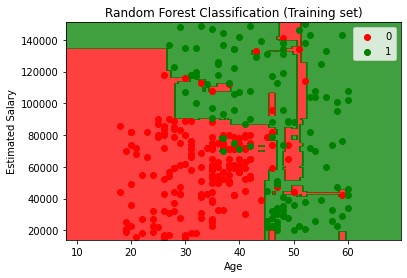

The decision boundary is similar to a single decision tree but smoother. The rectangular regions are still visible (a characteristic of tree-based models), but the ensemble averaging creates a more refined boundary. Small isolated regions from individual tree overfitting are reduced because most trees need to agree for a region to change class.

### Visualising the Test Set Results

```python
from matplotlib.colors import ListedColormap
X_set, y_set = sc.inverse_transform(X_test), y_test
X1, X2 = np.meshgrid(np.arange(start = X_set[:, 0].min() - 10, stop = X_set[:, 0].max() + 10, step = 0.25),
                     np.arange(start = X_set[:, 1].min() - 1000, stop = X_set[:, 1].max() + 1000, step = 0.25))
plt.contourf(X1, X2, classifier.predict(sc.transform(np.array([X1.ravel(), X2.ravel()]).T)).reshape(X1.shape),
             alpha = 0.75, cmap = ListedColormap(('red', 'green')))
plt.xlim(X1.min(), X1.max())
plt.ylim(X2.min(), X2.max())
for i, j in enumerate(np.unique(y_set)):
    plt.scatter(X_set[y_set == j, 0], X_set[y_set == j, 1], c = ListedColormap(('red', 'green'))(i), label = j)
plt.title('Random Forest Classification (Test set)')
plt.xlabel('Age')
plt.ylabel('Estimated Salary')
plt.legend()
plt.show()
```

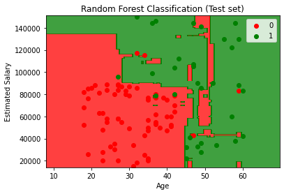


---

## K-Means Clustering

Clustering is an unsupervised learning technique that groups data points into clusters based on their similarity. Unlike classification, there are no predefined labels — the algorithm discovers the structure in the data on its own.

K-Means Clustering partitions the data into K clusters by iteratively assigning each data point to the nearest cluster centroid and then recalculating the centroid as the mean of all points in that cluster.

**How K-Means works:**

1. Choose the number of clusters K.
2. Randomly initialize K centroids (cluster centers).
3. Assign each data point to the nearest centroid (using Euclidean distance).
4. Recalculate each centroid as the mean of all points assigned to it.
5. Repeat steps 3-4 until the centroids no longer change (convergence).

**K-Means++ Initialization:** Standard random initialization can lead to poor clustering if centroids start too close together. K-Means++ solves this by choosing initial centroids that are spread apart — the first centroid is random, and each subsequent centroid is chosen with a probability proportional to its distance from the nearest existing centroid. This leads to faster convergence and better results.

**The Elbow Method:** Since K must be chosen in advance, the Elbow Method helps find the optimal value. It plots the Within-Cluster Sum of Squares (WCSS) against different values of K. WCSS decreases as K increases. The "elbow" — the point where the rate of decrease sharply changes — indicates the optimal K.

$$\text{WCSS} = \sum_{i=1}^{K} \sum_{x \in C_i} \|x - \mu_i\|^2$$

Where $C_i$ is the set of points in cluster $i$ and $\mu_i$ is the centroid of cluster $i$.

### Sample Dataset

The Mall Customers dataset contains customer information including Annual Income and Spending Score. The goal is to segment customers into distinct groups for targeted marketing.

### Importing Libraries

```python
import numpy as np
import matplotlib.pyplot as plt
import pandas as pd
```

### Importing the Dataset

```python
dataset = pd.read_csv('Mall_Customers.csv')
X = dataset.iloc[:, [3, 4]].values
```

`iloc[:, [3, 4]]` selects columns at index 3 (Annual Income) and 4 (Spending Score) as the features. Only these two features are used so the clusters can be visualized in 2D. There is no dependent variable (`y`) because clustering is unsupervised.

### Using the Elbow Method to Find the Optimal Number of Clusters

```python
from sklearn.cluster import KMeans
wcss = []
for i in range(1, 11):
    kmeans = KMeans(n_clusters = i, init = 'k-means++', random_state = 42)
    kmeans.fit(X)
    wcss.append(kmeans.inertia_)
plt.plot(range(1, 11), wcss)
plt.title('The Elbow Method')
plt.xlabel('Number of clusters')
plt.ylabel('WCSS')
plt.show()
```


A loop fits K-Means for K = 1 through 10. `init='k-means++'` uses the K-Means++ initialization for better centroid placement. `kmeans.inertia_` returns the WCSS for that model. The resulting plot shows a sharp decrease from 1 to 5 clusters, then a much slower decrease — the elbow is at K = 5, indicating 5 is the optimal number of clusters.

### Training the K-Means Model

```python
kmeans = KMeans(n_clusters = 5, init = 'k-means++', random_state = 42)
y_kmeans = kmeans.fit_predict(X)
```

`n_clusters=5` sets K to the optimal value found by the Elbow Method. `fit_predict(X)` trains the model and returns the cluster label (0–4) for each data point in a single step. `y_kmeans` is an array where each element is the cluster index assigned to the corresponding data point.

**Important `KMeans` parameters:**

| Parameter      | Purpose                                                                                                |
| -------------- | ------------------------------------------------------------------------------------------------------ |
| `n_clusters`   | Number of clusters K (default `8`)                                                                     |
| `init`         | Initialization method: `'k-means++'` (default) or `'random'`                                          |
| `n_init`       | Number of times the algorithm runs with different initializations (default `10`). Best result is kept   |
| `max_iter`     | Maximum iterations per run (default `300`)                                                             |
| `tol`          | Convergence tolerance (default `1e-4`). Algorithm stops when centroid movement is below this threshold |
| `random_state` | Seed for reproducibility                                                                               |
| `algorithm`    | Algorithm to use: `'lloyd'` (default), `'elkan'` (faster for well-defined clusters)                    |

### Visualising the Clusters

```python
plt.scatter(X[y_kmeans == 0, 0], X[y_kmeans == 0, 1], s = 100, c = 'red', label = 'Cluster 1')
plt.scatter(X[y_kmeans == 1, 0], X[y_kmeans == 1, 1], s = 100, c = 'blue', label = 'Cluster 2')
plt.scatter(X[y_kmeans == 2, 0], X[y_kmeans == 2, 1], s = 100, c = 'green', label = 'Cluster 3')
plt.scatter(X[y_kmeans == 3, 0], X[y_kmeans == 3, 1], s = 100, c = 'cyan', label = 'Cluster 4')
plt.scatter(X[y_kmeans == 4, 0], X[y_kmeans == 4, 1], s = 100, c = 'magenta', label = 'Cluster 5')
plt.scatter(kmeans.cluster_centers_[:, 0], kmeans.cluster_centers_[:, 1], s = 300, c = 'yellow', label = 'Centroids')
plt.title('Clusters of customers')
plt.xlabel('Annual Income (k$)')
plt.ylabel('Spending Score (1-100)')
plt.legend()
plt.show()
```


`X[y_kmeans == 0, 0]` selects the first feature (Annual Income) of all data points in cluster 0. Each cluster is plotted in a different color. `kmeans.cluster_centers_` contains the final centroid coordinates, plotted as larger yellow markers. The five clusters represent distinct customer segments: for example, high income/high spending, high income/low spending, low income/high spending, etc.

---

## Hierarchical Clustering

Hierarchical Clustering builds a hierarchy of clusters either by starting with each data point as its own cluster and merging them bottom-up (**agglomerative**), or by starting with one cluster and splitting top-down (**divisive**). The agglomerative approach is far more common.

**Agglomerative Hierarchical Clustering:**

1. Start with each data point as its own cluster (N clusters for N data points).
2. Find the two closest clusters and merge them into one.
3. Repeat step 2 until only one cluster remains.
4. Use a dendrogram to decide the optimal number of clusters.

**Linkage Methods** determine how the distance between two clusters is measured:

| Method     | Distance Between Clusters                                   |
| ---------- | ----------------------------------------------------------- |
| `ward`     | Minimizes the total within-cluster variance (most common)   |
| `complete` | Maximum distance between any two points in the two clusters |
| `average`  | Average distance between all pairs of points                |
| `single`   | Minimum distance between any two points in the two clusters |

**Dendrograms** are tree-like diagrams that show the order and distance of merges. To find the optimal number of clusters, find the tallest vertical line that does not cross any horizontal line (extended). The number of vertical lines this horizontal threshold crosses gives the optimal number of clusters.

### Sample Dataset

This uses the same Mall Customers dataset from K-Means Clustering.

### Importing Libraries

```python
import numpy as np
import matplotlib.pyplot as plt
import pandas as pd
```

### Importing the Dataset

```python
dataset = pd.read_csv('Mall_Customers.csv')
X = dataset.iloc[:, [3, 4]].values
```

### Using the Dendrogram to Find the Optimal Number of Clusters

```python
import scipy.cluster.hierarchy as sch
dendrogram = sch.dendrogram(sch.linkage(X, method = 'ward'))
plt.title('Dendrogram')
plt.xlabel('Customers')
plt.ylabel('Euclidean distances')
plt.show()
```


`sch.linkage(X, method='ward')` computes the hierarchical clustering linkage matrix using Ward's method, which minimizes the total within-cluster variance at each merge. `sch.dendrogram()` visualizes the hierarchy. The tallest vertical distance without a horizontal crossing is between 5 and 10 clusters, suggesting 5 as the optimal number.

### Training the Hierarchical Clustering Model

```python
from sklearn.cluster import AgglomerativeClustering
hc = AgglomerativeClustering(n_clusters = 5, affinity = 'euclidean', linkage = 'ward')
y_hc = hc.fit_predict(X)
```

`AgglomerativeClustering` creates an agglomerative hierarchical clustering model. `n_clusters=5` sets the number of clusters (determined from the dendrogram). `affinity='euclidean'` uses Euclidean distance to measure distances between data points. `linkage='ward'` minimizes variance when merging clusters. `fit_predict(X)` trains the model and returns cluster labels.

**Important `AgglomerativeClustering` parameters:**

| Parameter    | Purpose                                                                                    |
| ------------ | ------------------------------------------------------------------------------------------ |
| `n_clusters` | Number of clusters to find (default `2`)                                                   |
| `metric`     | Distance metric: `'euclidean'` (default), `'manhattan'`, `'cosine'`, etc.                  |
| `linkage`    | Linkage criterion: `'ward'` (default), `'complete'`, `'average'`, `'single'`               |
| `distance_threshold` | Distance threshold above which clusters are not merged. Use instead of `n_clusters` |

Note: `linkage='ward'` requires `metric='euclidean'`.

### Visualising the Clusters

```python
plt.scatter(X[y_hc == 0, 0], X[y_hc == 0, 1], s = 100, c = 'red', label = 'Cluster 1')
plt.scatter(X[y_hc == 1, 0], X[y_hc == 1, 1], s = 100, c = 'blue', label = 'Cluster 2')
plt.scatter(X[y_hc == 2, 0], X[y_hc == 2, 1], s = 100, c = 'green', label = 'Cluster 3')
plt.scatter(X[y_hc == 3, 0], X[y_hc == 3, 1], s = 100, c = 'cyan', label = 'Cluster 4')
plt.scatter(X[y_hc == 4, 0], X[y_hc == 4, 1], s = 100, c = 'magenta', label = 'Cluster 5')
plt.title('Clusters of customers')
plt.xlabel('Annual Income (k$)')
plt.ylabel('Spending Score (1-100)')
plt.legend()
plt.show()
```


The resulting clusters are very similar to those produced by K-Means. The key advantage of hierarchical clustering is the dendrogram, which provides a visual way to determine the number of clusters without trial and error. However, hierarchical clustering has higher computational complexity ($O(n^3)$ vs $O(n \cdot K \cdot i)$ for K-Means) and is less suitable for very large datasets.

---

## Apriori

Association Rule Learning discovers interesting relationships (associations) between variables in large datasets. The most common application is **Market Basket Analysis** — finding which products are frequently bought together so that stores can optimize product placement, cross-selling, and promotions.

**Key Concepts:**

- **Support:** The proportion of transactions that contain an itemset.

$$\text{Support}(A) = \frac{\text{Transactions containing } A}{\text{Total transactions}}$$

- **Confidence:** The proportion of transactions containing item A that also contain item B. It measures how often the rule is correct.

$$\text{Confidence}(A \rightarrow B) = \frac{\text{Transactions containing both } A \text{ and } B}{\text{Transactions containing } A}$$

- **Lift:** The ratio of the observed confidence to the expected confidence if A and B were independent. A lift > 1 indicates a positive association.

$$\text{Lift}(A \rightarrow B) = \frac{\text{Confidence}(A \rightarrow B)}{\text{Support}(B)}$$

**How Apriori works:**

1. Set minimum thresholds for support, confidence, and lift.
2. Find all itemsets with support above the minimum threshold.
3. Generate association rules from these frequent itemsets.
4. Filter rules by minimum confidence and lift.

The Apriori algorithm uses the **Apriori property**: if an itemset is infrequent, then all its supersets must also be infrequent. This allows the algorithm to prune the search space efficiently.

### Sample Dataset

The Market Basket Optimisation dataset contains 7,501 transactions from a grocery store, where each transaction lists the items purchased.

### Importing Libraries

```python
!pip install apyori
```

```python
import numpy as np
import matplotlib.pyplot as plt
import pandas as pd
```

### Data Preprocessing

```python
dataset = pd.read_csv('Market_Basket_Optimisation.csv', header = None)
transactions = []
for i in range(0, 7501):
  transactions.append([str(dataset.values[i,j]) for j in range(0, 20)])
```

`header=None` tells pandas there is no header row — all rows are data. The dataset has 20 columns (one per possible item in a transaction). The loop converts each row into a list of strings, creating a list of transactions. `str()` ensures all items are strings, including any `nan` values (empty slots in shorter transactions). The `apyori` library expects this list-of-lists format.

### Training the Apriori Model

```python
from apyori import apriori
rules = apriori(transactions = transactions, min_support = 0.003, min_confidence = 0.2, min_lift = 3, min_length = 2, max_length = 2)
```

`apriori()` runs the Apriori algorithm on the transaction data. `min_support=0.003` means an item pair must appear in at least 0.3% of transactions (about 22 out of 7,501). `min_confidence=0.2` means at least 20% of transactions containing item A must also contain item B. `min_lift=3` ensures the association is at least 3 times stronger than random chance. `min_length=2` and `max_length=2` restrict rules to pairs of items (no single items or triplets).

**Important `apriori` parameters:**

| Parameter        | Purpose                                                            |
| ---------------- | ------------------------------------------------------------------ |
| `transactions`   | List of transactions, where each transaction is a list of items    |
| `min_support`    | Minimum support threshold (default `0.1`)                          |
| `min_confidence` | Minimum confidence threshold (default `0.0`)                       |
| `min_lift`       | Minimum lift threshold (default `0.0`)                             |
| `min_length`     | Minimum number of items in a rule (default `1`)                    |
| `max_length`     | Maximum number of items in a rule (default `None`, no limit)       |

### Visualising the Results

```python
results = list(rules)
```

`list(rules)` converts the generator output into a list of `RelationRecord` objects, each containing the itemset, support, and ordered statistics (confidence and lift).

#### Organising Results into a DataFrame

```python
def inspect(results):
    lhs         = [tuple(result[2][0][0])[0] for result in results]
    rhs         = [tuple(result[2][0][1])[0] for result in results]
    supports    = [result[1] for result in results]
    confidences = [result[2][0][2] for result in results]
    lifts       = [result[2][0][3] for result in results]
    return list(zip(lhs, rhs, supports, confidences, lifts))
resultsinDataFrame = pd.DataFrame(inspect(results), columns = ['Left Hand Side', 'Right Hand Side', 'Support', 'Confidence', 'Lift'])
```

The `inspect` function extracts the left-hand side (antecedent), right-hand side (consequent), support, confidence, and lift from each result. `result[2][0][0]` accesses the items on the left side of the rule, `result[2][0][1]` the right side, `result[1]` the support, and `result[2][0][2]` and `result[2][0][3]` the confidence and lift respectively.

#### Displaying Results Sorted by Lift

```python
resultsinDataFrame.nlargest(n = 10, columns = 'Lift')
```

| Left Hand Side      | Right Hand Side | Support  | Confidence | Lift   |
| -------------------- | --------------- | -------- | ---------- | ------ |
| fromage blanc        | honey           | 0.003333 | 0.245098   | 5.1643 |
| light cream          | chicken         | 0.004533 | 0.290598   | 4.8440 |
| pasta                | escalope        | 0.005866 | 0.372881   | 4.7008 |
| pasta                | shrimp          | 0.005066 | 0.322034   | 4.5067 |
| whole wheat pasta    | olive oil       | 0.007999 | 0.271493   | 4.1224 |
| tomato sauce         | ground beef     | 0.005333 | 0.377358   | 3.8407 |
| mushroom cream sauce | escalope        | 0.005733 | 0.300699   | 3.7908 |
| herb & pepper        | ground beef     | 0.015998 | 0.323450   | 3.2920 |
| light cream          | olive oil       | 0.003200 | 0.205128   | 3.1147 |

The strongest association is between fromage blanc and honey (lift = 5.16), meaning customers who buy fromage blanc are about 5 times more likely to buy honey than a random customer. The herb & pepper → ground beef rule has the highest support (0.016), meaning it is the most frequently occurring pair.

---

## Eclat

Eclat (Equivalence Class Clustering and bottom-up Lattice Traversal) is a simpler association rule learning algorithm that uses only **support** as its metric. Unlike Apriori, which generates rules with support, confidence, and lift, Eclat focuses solely on finding frequently co-occurring itemsets.

**Key Difference from Apriori:**
- **Apriori** finds rules of the form "if A then B" with confidence and lift metrics.
- **Eclat** finds sets of items that frequently appear together, measured only by support.

Eclat is useful when you only need to know which items are bought together, without directional rules. It is computationally simpler and faster for finding frequent itemsets.

### Sample Dataset

This uses the same Market Basket Optimisation dataset from Apriori.

### Importing Libraries

```python
!pip install apyori
```

```python
import numpy as np
import matplotlib.pyplot as plt
import pandas as pd
```

### Data Preprocessing

```python
dataset = pd.read_csv('Market_Basket_Optimisation.csv', header = None)
transactions = []
for i in range(0, 7501):
  transactions.append([str(dataset.values[i,j]) for j in range(0, 20)])
```

### Training the Eclat Model

```python
from apyori import apriori
rules = apriori(transactions = transactions, min_support = 0.003, min_confidence = 0.2, min_lift = 3, min_length = 2, max_length = 2)
```

The `apyori` library does not have a separate Eclat implementation. The Apriori function is used with the same parameters, but only the support metric is extracted from the results. The conceptual difference is in how the results are interpreted — Eclat treats associations as symmetric (A and B appear together) rather than directional (A leads to B).

### Visualising the Results

```python
results = list(rules)
```

#### Organising Results into a DataFrame

```python
def inspect(results):
    lhs         = [tuple(result[2][0][0])[0] for result in results]
    rhs         = [tuple(result[2][0][1])[0] for result in results]
    supports    = [result[1] for result in results]
    return list(zip(lhs, rhs, supports))
resultsinDataFrame = pd.DataFrame(inspect(results), columns = ['Product 1', 'Product 2', 'Support'])
```

Unlike the Apriori results, only the support metric is extracted. The columns are labeled "Product 1" and "Product 2" (rather than "Left Hand Side" and "Right Hand Side") because Eclat treats the association as symmetric — there is no directionality.

#### Displaying Results Sorted by Support

```python
resultsinDataFrame.nlargest(n = 10, columns = 'Support')
```

| Product 1            | Product 2   | Support  |
| -------------------- | ----------- | -------- |
| herb & pepper        | ground beef | 0.015998 |
| whole wheat pasta    | olive oil   | 0.007999 |
| pasta                | escalope    | 0.005866 |
| mushroom cream sauce | escalope    | 0.005733 |
| tomato sauce         | ground beef | 0.005333 |
| pasta                | shrimp      | 0.005066 |
| light cream          | chicken     | 0.004533 |
| fromage blanc        | honey       | 0.003333 |
| light cream          | olive oil   | 0.003200 |

The most frequently co-occurring pair is herb & pepper with ground beef (support = 0.016, appearing in about 1.6% of all transactions). Sorting by support (instead of lift as in Apriori) highlights the most common combinations rather than the strongest associations, which may be more useful for inventory management and product placement decisions.

---

## Upper Confidence Bound (UCB)

Reinforcement Learning is a branch of ML where an agent learns to make decisions by interacting with an environment and receiving rewards or penalties. Unlike supervised learning (which learns from labeled data), reinforcement learning learns from the consequences of its actions.

The **Multi-Armed Bandit Problem** is a classic reinforcement learning scenario. Imagine a row of slot machines (bandits), each with a different (unknown) probability of paying out. The goal is to maximize the total reward over a series of rounds by choosing which machine to play. This requires balancing **exploration** (trying different machines to learn their payouts) and **exploitation** (playing the machine currently believed to be the best).

**Real-world applications:** Online ad selection (which ad to show), A/B testing, clinical trials (which treatment to assign), recommendation systems.

The **Upper Confidence Bound (UCB)** algorithm solves this problem deterministically by computing a confidence bound for each option and always selecting the option with the highest upper bound.

**How UCB works:**

At each round $n$, for each option $i$:

1. Compute the average reward: $\bar{r}_i = \frac{\text{total reward from } i}{\text{number of times } i \text{ was selected}}$
2. Compute the confidence interval: $\Delta_i = \sqrt{\frac{3}{2} \cdot \frac{\ln(n)}{N_i}}$ where $N_i$ is the number of times option $i$ has been selected.
3. Compute the upper confidence bound: $\text{UCB}_i = \bar{r}_i + \Delta_i$
4. Select the option with the highest $\text{UCB}_i$.

The confidence interval shrinks as an option is selected more often (more certainty about its true reward). Options that have been explored less have wider confidence intervals, encouraging exploration. This naturally balances exploration and exploitation without any randomness.

### Sample Dataset

The Ads CTR Optimisation dataset simulates 10,000 rounds of showing one of 10 ads to users. Each cell contains 1 (user clicked) or 0 (user did not click). The goal is to find the best-performing ad as quickly as possible while maximizing total clicks.

### Importing Libraries

```python
import numpy as np
import matplotlib.pyplot as plt
import pandas as pd
```

### Importing the Dataset

```python
dataset = pd.read_csv('Ads_CTR_Optimisation.csv')
```

### Implementing UCB

```python
import math
N = 10000
d = 10
ads_selected = []
numbers_of_selections = [0] * d
sums_of_rewards = [0] * d
total_reward = 0
for n in range(0, N):
    ad = 0
    max_upper_bound = 0
    for i in range(0, d):
        if (numbers_of_selections[i] > 0):
            average_reward = sums_of_rewards[i] / numbers_of_selections[i]
            delta_i = math.sqrt(3/2 * math.log(n + 1) / numbers_of_selections[i])
            upper_bound = average_reward + delta_i
        else:
            upper_bound = 1e400
        if upper_bound > max_upper_bound:
            max_upper_bound = upper_bound
            ad = i
    ads_selected.append(ad)
    numbers_of_selections[ad] = numbers_of_selections[ad] + 1
    reward = dataset.values[n, ad]
    sums_of_rewards[ad] = sums_of_rewards[ad] + reward
    total_reward = total_reward + reward
```

`N = 10000` is the total number of rounds. `d = 10` is the number of ads (options). `numbers_of_selections` tracks how many times each ad has been selected. `sums_of_rewards` tracks the cumulative reward for each ad. `upper_bound = 1e400` (effectively infinity) ensures that each ad is selected at least once before any comparisons begin. `math.sqrt(3/2 * math.log(n + 1) / numbers_of_selections[i])` computes the confidence interval — it decreases as an ad is selected more often (narrower uncertainty) and increases with total rounds (broader exploration early on). The ad with the highest upper bound is selected at each round, and its reward (0 or 1) is recorded.

### Visualising the Results

```python
plt.hist(ads_selected)
plt.title('Histogram of ads selections')
plt.xlabel('Ads')
plt.ylabel('Number of times each ad was selected')
plt.show()
```


The histogram shows that UCB quickly identifies the best-performing ad (the one with the tallest bar) and selects it far more often than the others. The other ads are selected only enough times to establish that they are inferior. This demonstrates the exploration-exploitation balance: the algorithm explores enough to be confident about each ad's performance, then exploits the best one.

---

## Thompson Sampling

Thompson Sampling is another algorithm for the Multi-Armed Bandit Problem. Unlike UCB, which is deterministic, Thompson Sampling uses a **probabilistic (Bayesian)** approach. It maintains a probability distribution for each option's expected reward and samples from these distributions to decide which option to select.

**How Thompson Sampling works:**

At each round $n$, for each option $i$:

1. Maintain counts of successes ($N_i^1$) and failures ($N_i^0$) for each option.
2. Sample a random value $\theta_i$ from the Beta distribution: $\theta_i \sim \text{Beta}(N_i^1 + 1, N_i^0 + 1)$
3. Select the option with the highest sampled $\theta_i$.
4. Update the success/failure counts based on the observed reward.

The Beta distribution naturally represents uncertainty about a probability. Initially (with few observations), the distribution is wide (high uncertainty), encouraging exploration. As more data is collected, the distribution narrows around the true reward probability, favoring exploitation.

**Thompson Sampling vs UCB:**

| Aspect              | UCB                                    | Thompson Sampling                     |
| ------------------- | -------------------------------------- | ------------------------------------- |
| Approach            | Deterministic (confidence bounds)      | Probabilistic (Bayesian sampling)     |
| Exploration method  | Upper confidence bound forces it       | Random sampling from distributions    |
| Adaptability        | Fixed formula                          | Adapts as distributions update        |
| Performance         | Good theoretical guarantees            | Often better empirically              |
| Delayed feedback    | Requires immediate reward observation  | Can accommodate delayed rewards       |

### Sample Dataset

This uses the same Ads CTR Optimisation dataset.

### Importing Libraries

```python
import numpy as np
import matplotlib.pyplot as plt
import pandas as pd
```

### Importing the Dataset

```python
dataset = pd.read_csv('Ads_CTR_Optimisation.csv')
```

### Implementing Thompson Sampling

```python
import random
N = 10000
d = 10
ads_selected = []
numbers_of_rewards_1 = [0] * d
numbers_of_rewards_0 = [0] * d
total_reward = 0
for n in range(0, N):
    ad = 0
    max_random = 0
    for i in range(0, d):
        random_beta = random.betavariate(numbers_of_rewards_1[i] + 1, numbers_of_rewards_0[i] + 1)
        if random_beta > max_random:
            max_random = random_beta
            ad = i
    ads_selected.append(ad)
    reward = dataset.values[n, ad]
    if reward == 1:
        numbers_of_rewards_1[ad] = numbers_of_rewards_1[ad] + 1
    else:
        numbers_of_rewards_0[ad] = numbers_of_rewards_0[ad] + 1
    total_reward = total_reward + reward
```

`numbers_of_rewards_1` tracks the number of times each ad received a reward of 1 (click). `numbers_of_rewards_0` tracks the number of times each ad received a reward of 0 (no click). `random.betavariate(a, b)` draws a random sample from the Beta distribution with parameters $a = N_i^1 + 1$ and $b = N_i^0 + 1$. The +1 ensures the initial distribution is $\text{Beta}(1, 1)$, which is a uniform distribution (no prior knowledge). The ad with the highest sampled value is selected, its actual reward is observed, and the corresponding counter is updated.

### Visualising the Results

```python
plt.hist(ads_selected)
plt.title('Histogram of ads selections')
plt.xlabel('Ads')
plt.ylabel('Number of times each ad was selected')
plt.show()
```


The histogram shows an even more concentrated selection of the best ad compared to UCB. Thompson Sampling typically converges faster to the optimal choice because the probabilistic sampling naturally focuses on high-performing options while still occasionally exploring others. The total reward from Thompson Sampling is generally equal to or better than UCB.

---

## Natural Language Processing

Natural Language Processing (NLP) applies ML techniques to text data. A common NLP task is **sentiment analysis** — classifying text (e.g., reviews, tweets) as positive or negative.

**The NLP Pipeline:**

1. **Text Cleaning** — Remove non-alphabetic characters, convert to lowercase, remove stopwords, and apply stemming.
2. **Bag of Words Model** — Convert the cleaned text into a numerical feature matrix that ML models can process.
3. **Model Training** — Apply a classification algorithm (e.g., Naive Bayes) to the feature matrix.

### Sample Dataset

The Restaurant Reviews dataset contains 1,000 restaurant reviews, each labeled as positive (1) or negative (0). The data is stored as a TSV (Tab-Separated Values) file because reviews may contain commas.

### Importing Libraries

```python
import numpy as np
import matplotlib.pyplot as plt
import pandas as pd
```

### Importing the Dataset

```python
dataset = pd.read_csv('Restaurant_Reviews.tsv', delimiter = '\t', quoting = 3)
```

`delimiter='\t'` specifies that columns are separated by tabs (not commas). `quoting=3` corresponds to `csv.QUOTE_NONE`, which tells pandas to ignore quote characters in the file. This prevents errors when reviews contain quotation marks.

### Cleaning the Texts

```python
import re
import nltk
nltk.download('stopwords')
from nltk.corpus import stopwords
from nltk.stem.porter import PorterStemmer
corpus = []
for i in range(0, 1000):
  review = re.sub('[^a-zA-Z]', ' ', dataset['Review'][i])
  review = review.lower()
  review = review.split()
  ps = PorterStemmer()
  all_stopwords = stopwords.words('english')
  all_stopwords.remove('not')
  review = [ps.stem(word) for word in review if not word in set(all_stopwords)]
  review = ' '.join(review)
  corpus.append(review)
```

The cleaning process for each review:

1. `re.sub('[^a-zA-Z]', ' ', ...)` removes all non-alphabetic characters (numbers, punctuation) and replaces them with spaces. This eliminates noise that does not contribute to sentiment.
2. `.lower()` converts to lowercase so "Good" and "good" are treated as the same word.
3. `.split()` splits the string into a list of individual words.
4. `PorterStemmer()` reduces words to their root form: "loved" → "love", "eating" → "eat", "delicious" → "delici". This reduces vocabulary size and groups related words together.
5. `stopwords.words('english')` loads common English words that carry little meaning ("the", "is", "at", "and"). These are removed to reduce noise. Importantly, `'not'` is removed from the stopwords list because it carries critical sentiment information ("not good" vs "good").
6. `set(all_stopwords)` converts to a set for O(1) lookup instead of O(n) list lookup.
7. `' '.join(review)` reassembles the cleaned words into a single string.
8. `corpus` collects all cleaned reviews for the Bag of Words model.

### Creating the Bag of Words Model

```python
from sklearn.feature_extraction.text import CountVectorizer
cv = CountVectorizer(max_features = 1500)
X = cv.fit_transform(corpus).toarray()
y = dataset.iloc[:, -1].values
```

The **Bag of Words** model converts text into a numerical matrix where each row is a review and each column is a unique word from the entire corpus. The value in each cell is the number of times that word appears in that review.

`CountVectorizer` creates this matrix. `max_features=1500` limits the vocabulary to the 1,500 most frequent words, reducing dimensionality and removing rare words that may just be noise. `fit_transform(corpus)` learns the vocabulary and transforms the text in one step. `.toarray()` converts the sparse matrix to a dense NumPy array. `y = dataset.iloc[:, -1].values` extracts the sentiment labels (0 or 1).

**Important `CountVectorizer` parameters:**

| Parameter      | Purpose                                                                                   |
| -------------- | ----------------------------------------------------------------------------------------- |
| `max_features` | Maximum number of features (words) to keep. `None` (default) keeps all                   |
| `max_df`       | Ignore words appearing in more than this fraction of documents (e.g., `0.9`)              |
| `min_df`       | Ignore words appearing in fewer than this number of documents (e.g., `5`)                 |
| `ngram_range`  | Range of n-grams: `(1, 1)` (default) for unigrams, `(1, 2)` for unigrams and bigrams    |
| `stop_words`   | `'english'` to use built-in stopwords, or pass a custom list                              |
| `binary`       | `True` counts presence/absence instead of frequency                                       |

**Alternative: TF-IDF** (`TfidfVectorizer`) weights words by their importance — common words across many documents get lower weights, while distinctive words get higher weights. This often performs better than raw counts.

### Splitting the Dataset

```python
from sklearn.model_selection import train_test_split
X_train, X_test, y_train, y_test = train_test_split(X, y, test_size = 0.20, random_state = 0)
```

`test_size=0.20` allocates 200 reviews to the test set and 800 to the training set.

### Training the Naive Bayes Model

```python
from sklearn.naive_bayes import GaussianNB
classifier = GaussianNB()
classifier.fit(X_train, y_train)
```

Naive Bayes is a natural choice for text classification because it handles high-dimensional sparse data well, is fast to train, and works on the independence assumption that suits the Bag of Words representation (each word's presence is treated as an independent feature).

### Predicting the Test Set Results

```python
y_pred = classifier.predict(X_test)
print(np.concatenate((y_pred.reshape(len(y_pred),1), y_test.reshape(len(y_test),1)),1))
```

`predict(X_test)` classifies each test review as positive (1) or negative (0) based on the word frequencies. The concatenated output shows predicted vs actual labels side by side.

### Making the Confusion Matrix

```python
from sklearn.metrics import confusion_matrix, accuracy_score
cm = confusion_matrix(y_test, y_pred)
print(cm)
accuracy_score(y_test, y_pred)
```

```text
[[55 42]
 [12 91]]
```

```text
0.73
```

The model achieves 73% accuracy. The confusion matrix shows 55 true negatives, 91 true positives, 42 false positives (negative reviews incorrectly classified as positive), and 12 false negatives (positive reviews incorrectly classified as negative). The high false positive rate (42) suggests the model tends to over-predict positive sentiment.

To improve performance, you could try: using `TfidfVectorizer` instead of `CountVectorizer`, tuning `max_features`, using bigrams (`ngram_range=(1, 2)`), trying different classifiers (SVM often excels at text classification), or using more sophisticated text preprocessing (lemmatization instead of stemming).


---

## Artificial Neural Networks (ANN)

Deep Learning is a subset of Machine Learning that uses artificial neural networks with multiple layers to learn complex patterns from data. Neural networks are inspired by the structure of the human brain, where interconnected neurons process and transmit information.

**Structure of a Neural Network:**

- **Input Layer:** Receives the features (one neuron per feature).
- **Hidden Layers:** One or more layers of neurons that learn intermediate representations. Each neuron computes a weighted sum of its inputs, adds a bias, and applies an activation function.
- **Output Layer:** Produces the final prediction (one neuron for binary classification, multiple neurons for multiclass).

**How a Neuron Works:**

$$z = \sum_{i=1}^{n} w_i x_i + b$$

$$a = f(z)$$

Where $x_i$ are inputs, $w_i$ are weights, $b$ is the bias, $z$ is the weighted sum, $f$ is the activation function, and $a$ is the neuron's output.

**Common Activation Functions:**

| Function | Formula | Use Case |
| -------- | ------- | -------- |
| ReLU | $f(z) = \max(0, z)$ | Hidden layers (most common) |
| Sigmoid | $f(z) = \frac{1}{1 + e^{-z}}$ | Binary classification output |
| Softmax | $f(z_i) = \frac{e^{z_i}}{\sum_j e^{z_j}}$ | Multiclass classification output |
| Tanh | $f(z) = \tanh(z)$ | Hidden layers (alternative to ReLU) |

**Training a Neural Network:**

1. **Forward Propagation:** Input passes through each layer, producing a prediction.
2. **Loss Calculation:** The difference between the prediction and the actual value is computed using a loss function.
3. **Backpropagation:** The gradient of the loss with respect to each weight is computed (chain rule).
4. **Weight Update:** The optimizer (e.g., Adam) adjusts the weights to minimize the loss.
5. Steps 1-4 repeat for each batch of data across multiple epochs.

### Sample Dataset

The Churn Modelling dataset predicts whether a bank customer will leave (churn). Features include Credit Score, Geography, Gender, Age, Tenure, Balance, Number of Products, Has Credit Card, Is Active Member, and Estimated Salary. The dependent variable is Exited (1 = left, 0 = stayed).

### Importing Libraries

```python
import numpy as np
import pandas as pd
import tensorflow as tf
```

```python
tf.__version__
```

```text
'2.2.0'
```

`tensorflow` is Google's open-source deep learning framework. It provides the `keras` API for building, training, and evaluating neural networks.

### Importing the Dataset

```python
dataset = pd.read_csv('Churn_Modelling.csv')
X = dataset.iloc[:, 3:-1].values
y = dataset.iloc[:, -1].values
```

`iloc[:, 3:-1]` skips the first three columns (RowNumber, CustomerId, Surname) because they are identifiers that provide no predictive value. The features start at column 3 (CreditScore) and end before the last column (Exited).

### Encoding Categorical Data

#### Label Encoding the "Gender" Column

```python
from sklearn.preprocessing import LabelEncoder
le = LabelEncoder()
X[:, 2] = le.fit_transform(X[:, 2])
```

Gender (Male/Female) is binary, so Label Encoding is sufficient. Male becomes 1 and Female becomes 0 (or vice versa). There is no ordinal relationship to worry about with only two categories.

#### One-Hot Encoding the "Geography" Column

```python
from sklearn.compose import ColumnTransformer
from sklearn.preprocessing import OneHotEncoder
ct = ColumnTransformer(transformers=[('encoder', OneHotEncoder(), [1])], remainder='passthrough')
X = np.array(ct.fit_transform(X))
```

Geography has three categories (France, Germany, Spain), so One-Hot Encoding is used to avoid imposing a false numerical order. `[1]` targets column index 1 (Geography). The three country values become three binary columns placed at the beginning of the feature matrix.

### Splitting the Dataset

```python
from sklearn.model_selection import train_test_split
X_train, X_test, y_train, y_test = train_test_split(X, y, test_size = 0.2, random_state = 0)
```

### Feature Scaling

```python
from sklearn.preprocessing import StandardScaler
sc = StandardScaler()
X_train = sc.fit_transform(X_train)
X_test = sc.transform(X_test)
```

Feature scaling is essential for neural networks. Without it, features with large values (e.g., Balance: 0–250,000) would dominate the gradient updates, causing slow or unstable training. All features are scaled here, including the dummy variables, because neural networks treat all inputs symmetrically — unlike decision trees, there is no threshold-based splitting where binary columns would remain meaningful without scaling.

### Building the ANN

#### Initializing the ANN

```python
ann = tf.keras.models.Sequential()
```

`Sequential()` creates a neural network as a linear stack of layers. Layers are added one at a time, and each layer's output feeds into the next layer.

#### Adding the Input Layer and First Hidden Layer

```python
ann.add(tf.keras.layers.Dense(units=6, activation='relu'))
```

`Dense` creates a fully connected layer where every neuron is connected to every neuron in the previous layer. `units=6` specifies 6 neurons in this hidden layer. `activation='relu'` applies the Rectified Linear Unit function: $f(z) = \max(0, z)$. ReLU is the standard choice for hidden layers because it avoids the vanishing gradient problem and is computationally efficient. The input layer is automatically inferred from the shape of the training data on the first `fit()` call.

#### Adding the Second Hidden Layer

```python
ann.add(tf.keras.layers.Dense(units=6, activation='relu'))
```

A second hidden layer with 6 neurons and ReLU activation. There is no strict rule for the number of hidden layers or neurons — common practice is to start with one or two hidden layers and experiment. The number of neurons is often chosen as the average of the input and output layer sizes, or through hyperparameter tuning.

#### Adding the Output Layer

```python
ann.add(tf.keras.layers.Dense(units=1, activation='sigmoid'))
```

`units=1` because this is binary classification (one output probability). `activation='sigmoid'` squashes the output to the range (0, 1), representing the probability that the customer will churn. For multiclass classification, use `units=n_classes` with `activation='softmax'`.

**Important `Dense` layer parameters:**

| Parameter         | Purpose                                                                                    |
| ----------------- | ------------------------------------------------------------------------------------------ |
| `units`           | Number of neurons in the layer                                                             |
| `activation`      | Activation function: `'relu'`, `'sigmoid'`, `'softmax'`, `'tanh'`, `None` (linear)        |
| `kernel_initializer` | Weight initialization: `'glorot_uniform'` (default), `'he_uniform'`, `'zeros'`          |
| `use_bias`        | `True` (default) adds a bias term to each neuron                                           |
| `kernel_regularizer` | Regularization: `None` (default), `'l1'`, `'l2'`, `'l1_l2'`                            |

### Compiling the ANN

```python
ann.compile(optimizer = 'adam', loss = 'binary_crossentropy', metrics = ['accuracy'])
```

`compile()` configures the training process. `optimizer='adam'` uses the Adam optimizer, which adapts the learning rate for each parameter individually — it is the most popular optimizer for deep learning. `loss='binary_crossentropy'` is the loss function for binary classification, measuring the difference between predicted probabilities and actual labels. For multiclass classification, use `'categorical_crossentropy'`. `metrics=['accuracy']` tracks accuracy during training for monitoring purposes.

**Common optimizers:**

| Optimizer | Description |
| --------- | ----------- |
| `'sgd'` | Stochastic Gradient Descent. Simple but may converge slowly |
| `'adam'` | Adaptive Moment Estimation. Best default choice for most problems |
| `'rmsprop'` | Good for recurrent neural networks |
| `'adagrad'` | Adapts learning rate per parameter. Good for sparse data |

**Common loss functions:**

| Loss Function | Use Case |
| ------------- | -------- |
| `'binary_crossentropy'` | Binary classification |
| `'categorical_crossentropy'` | Multiclass classification (one-hot encoded labels) |
| `'sparse_categorical_crossentropy'` | Multiclass classification (integer labels) |
| `'mean_squared_error'` | Regression |

### Training the ANN

```python
ann.fit(X_train, y_train, batch_size = 32, epochs = 100)
```

`fit()` trains the neural network. `batch_size=32` means the model updates weights after processing every 32 samples (mini-batch gradient descent). This is a balance between speed (large batches) and generalization (small batches). `epochs=100` means the entire training set is passed through the network 100 times. The training output shows the loss and accuracy improving over epochs — the loss decreases from approximately 0.80 to 0.33 and the accuracy increases from approximately 52% to 86%.

**Important `fit()` parameters:**

| Parameter         | Purpose                                                                                 |
| ----------------- | --------------------------------------------------------------------------------------- |
| `batch_size`      | Number of samples per gradient update (default `32`)                                    |
| `epochs`          | Number of complete passes through the training data                                     |
| `validation_data` | Tuple `(X_val, y_val)` to evaluate on after each epoch                                  |
| `validation_split`| Fraction of training data to use as validation (e.g., `0.1`)                            |
| `callbacks`       | List of callbacks (e.g., `EarlyStopping`, `ModelCheckpoint`)                            |
| `verbose`         | `1` (default) shows progress bar, `0` is silent, `2` shows one line per epoch           |

### Predicting a Single Result

```python
print(ann.predict(sc.transform([[1, 0, 0, 600, 1, 40, 3, 60000, 2, 1, 1, 50000]])) > 0.5)
```

```text
[[False]]
```

The model predicts that a 40-year-old French male with a credit score of 600, 3-year tenure, \$60,000 balance, 2 products, credit card, active membership, and \$50,000 salary will **not** churn. The input must be scaled with `sc.transform()` because the model was trained on scaled data. The `> 0.5` converts the probability to a binary prediction. The dummy variables `[1, 0, 0]` encode France (as determined by the `ColumnTransformer` ordering).

### Predicting the Test Set Results

```python
y_pred = ann.predict(X_test)
y_pred = (y_pred > 0.5)
print(np.concatenate((y_pred.reshape(len(y_pred),1), y_test.reshape(len(y_test),1)),1))
```

`ann.predict(X_test)` returns probabilities for each test sample. `(y_pred > 0.5)` converts probabilities to binary predictions (True/False, treated as 1/0). The concatenated output shows predicted vs actual labels side by side.

### Making the Confusion Matrix

```python
from sklearn.metrics import confusion_matrix, accuracy_score
cm = confusion_matrix(y_test, y_pred)
print(cm)
accuracy_score(y_test, y_pred)
```

```text
[[1516   79]
 [ 200  205]]
```

```text
0.8605
```

The ANN achieves 86.05% accuracy on the test set. The confusion matrix shows 1,516 true negatives, 205 true positives, 79 false positives, and 200 false negatives. The relatively high false negative count (200) means the model misses some customers who will actually churn — this could be improved with class balancing, more epochs, or a different architecture.

---

## Convolutional Neural Networks (CNN)

Convolutional Neural Networks are specialized neural networks designed for processing structured grid data, particularly images. While a standard ANN treats each input feature independently, a CNN exploits the spatial structure of images by using convolutional filters that detect local patterns (edges, textures, shapes).

**CNN Architecture:**

1. **Convolution Layer:** Applies filters (kernels) that slide across the image, producing feature maps that detect specific patterns. Each filter learns to recognize a particular feature (e.g., vertical edges, curves).
2. **Pooling Layer (Max Pooling):** Reduces the spatial dimensions of each feature map by taking the maximum value in each region. This reduces computation, provides translation invariance, and prevents overfitting.
3. **Flattening:** Converts the 2D feature maps into a 1D vector that can be fed into fully connected layers.
4. **Fully Connected Layers:** Standard ANN layers that combine the extracted features to make the final classification.

**Key Concepts:**

- **Feature Map:** The output of applying a filter to the input image. Each filter produces one feature map.
- **Kernel/Filter:** A small matrix (e.g., 3×3) of learnable weights that slides across the image.
- **Stride:** The number of pixels the filter moves at each step (default 1).
- **Padding:** Adding zeros around the image border to preserve spatial dimensions.
- **Data Augmentation:** Applying random transformations (rotation, flip, zoom) to training images to prevent overfitting and increase effective dataset size.

### Sample Dataset

The Cats vs Dogs dataset contains images of cats and dogs organized into training and test directories. The task is binary classification — given an image, predict whether it is a cat or a dog.

### Importing Libraries

```python
import tensorflow as tf
from tensorflow.keras.preprocessing.image import ImageDataGenerator
```

`ImageDataGenerator` provides real-time data augmentation and loads images directly from directories.

### Preprocessing the Training Set

```python
train_datagen = ImageDataGenerator(rescale = 1./255,
                                   shear_range = 0.2,
                                   zoom_range = 0.2,
                                   horizontal_flip = True)
training_set = train_datagen.flow_from_directory('dataset/training_set',
                                                 target_size = (64, 64),
                                                 batch_size = 32,
                                                 class_mode = 'binary')
```

`rescale=1./255` normalizes pixel values from [0, 255] to [0, 1] — this is feature scaling for images. `shear_range=0.2` applies random shearing transformations. `zoom_range=0.2` applies random zoom. `horizontal_flip=True` randomly flips images horizontally. These augmentations artificially expand the training set, reducing overfitting by ensuring the model sees varied versions of each image.

`flow_from_directory()` loads images directly from the folder structure. `target_size=(64, 64)` resizes all images to 64×64 pixels (smaller images train faster but with less detail). `batch_size=32` loads 32 images at a time. `class_mode='binary'` generates binary labels (0 or 1). The directory must have subdirectories for each class (e.g., `cats/` and `dogs/`).

**Important `ImageDataGenerator` parameters:**

| Parameter          | Purpose                                                                  |
| ------------------ | ------------------------------------------------------------------------ |
| `rescale`          | Rescaling factor (e.g., `1./255` to normalize pixels)                   |
| `rotation_range`   | Degree range for random rotations (e.g., `40`)                          |
| `width_shift_range`| Fraction of total width for random horizontal shifts                     |
| `height_shift_range`| Fraction of total height for random vertical shifts                     |
| `shear_range`      | Shear intensity                                                          |
| `zoom_range`       | Range for random zoom                                                    |
| `horizontal_flip`  | Randomly flip images horizontally                                        |
| `fill_mode`        | How to fill newly created pixels: `'nearest'` (default), `'reflect'`     |

### Preprocessing the Test Set

```python
test_datagen = ImageDataGenerator(rescale = 1./255)
test_set = test_datagen.flow_from_directory('dataset/test_set',
                                            target_size = (64, 64),
                                            batch_size = 32,
                                            class_mode = 'binary')
```

The test set is only rescaled, **not augmented**. Data augmentation is applied only to the training set to increase diversity during learning. The test set must remain unchanged to provide an honest evaluation of the model's performance on real-world data.

### Building the CNN

#### Initializing the CNN

```python
cnn = tf.keras.models.Sequential()
```

#### Step 1 — Convolution

```python
cnn.add(tf.keras.layers.Conv2D(filters=32, kernel_size=3, activation='relu', input_shape=[64, 64, 3]))
```

`Conv2D` creates a 2D convolutional layer. `filters=32` creates 32 different filters, each learning to detect a different feature. `kernel_size=3` uses 3×3 filters. `activation='relu'` applies ReLU to the feature maps. `input_shape=[64, 64, 3]` specifies the input dimensions: 64×64 pixels with 3 color channels (RGB). This parameter is only needed for the first layer.

**Important `Conv2D` parameters:**

| Parameter      | Purpose                                                                    |
| -------------- | -------------------------------------------------------------------------- |
| `filters`      | Number of output filters (feature detectors)                               |
| `kernel_size`  | Size of the convolution window (e.g., `3` for 3×3, or `(3, 3)`)           |
| `strides`      | Step size of the filter (default `(1, 1)`)                                 |
| `padding`      | `'valid'` (default, no padding) or `'same'` (pad to preserve dimensions)  |
| `activation`   | Activation function to apply                                               |
| `input_shape`  | Shape of the input (only for the first layer)                              |

#### Step 2 — Pooling

```python
cnn.add(tf.keras.layers.MaxPool2D(pool_size=2, strides=2))
```

`MaxPool2D` applies max pooling with a 2×2 window and stride of 2. This reduces each feature map's dimensions by half (e.g., 62×62 → 31×31), keeping only the most prominent features in each 2×2 region. This reduces computation and provides spatial invariance — the model becomes less sensitive to the exact position of features.

#### Adding a Second Convolutional Layer

```python
cnn.add(tf.keras.layers.Conv2D(filters=32, kernel_size=3, activation='relu'))
cnn.add(tf.keras.layers.MaxPool2D(pool_size=2, strides=2))
```

A second convolution + pooling block. Deeper layers detect higher-level features: the first layer might detect edges, while the second detects combinations of edges (shapes, textures). `input_shape` is not needed here because it is inferred from the previous layer.

#### Step 3 — Flattening

```python
cnn.add(tf.keras.layers.Flatten())
```

`Flatten()` converts the 2D feature maps into a 1D vector. If the previous layer outputs 32 feature maps of size 14×14, flattening produces a vector of 32 × 14 × 14 = 6,272 neurons. This 1D vector is then fed into fully connected layers.

#### Step 4 — Full Connection

```python
cnn.add(tf.keras.layers.Dense(units=128, activation='relu'))
```

A fully connected hidden layer with 128 neurons. This layer combines the features extracted by the convolutional layers to learn complex patterns for classification.

#### Step 5 — Output Layer

```python
cnn.add(tf.keras.layers.Dense(units=1, activation='sigmoid'))
```

`units=1` with `sigmoid` for binary classification (cat vs dog). For multiclass classification with N classes, use `units=N` with `activation='softmax'`.

### Compiling the CNN

```python
cnn.compile(optimizer = 'adam', loss = 'binary_crossentropy', metrics = ['accuracy'])
```

Same compilation as the ANN: Adam optimizer, binary cross-entropy loss, and accuracy tracking.

### Training the CNN

```python
cnn.fit(x = training_set, validation_data = test_set, epochs = 25)
```

`x=training_set` passes the augmented training data generator. `validation_data=test_set` evaluates on the test set after each epoch, allowing you to monitor overfitting (training accuracy increasing while validation accuracy plateaus or decreases). `epochs=25` trains for 25 complete passes through the training data.

### Making a Single Prediction

```python
import numpy as np
from tensorflow.keras.preprocessing import image
test_image = image.load_img('dataset/single_prediction/cat_or_dog_1.jpg', target_size = (64, 64))
test_image = image.img_to_array(test_image)
test_image = np.expand_dims(test_image, axis = 0)
result = cnn.predict(test_image)
training_set.class_indices
if result[0][0] == 1:
  prediction = 'dog'
else:
  prediction = 'cat'
```

```python
print(prediction)
```

`image.load_img()` loads and resizes the image to 64×64 (matching the training size). `image.img_to_array()` converts the PIL image to a NumPy array. `np.expand_dims(test_image, axis=0)` adds a batch dimension because `predict()` expects a batch of images (shape changes from `[64, 64, 3]` to `[1, 64, 64, 3]`). `training_set.class_indices` shows the mapping from class names to integer labels (e.g., `{'cats': 0, 'dogs': 1}`). The prediction is decoded based on this mapping.

---

## Principal Component Analysis (PCA)

Dimensionality Reduction reduces the number of features in a dataset while retaining as much information as possible. This is useful when dealing with many features that may be correlated, redundant, or noisy. Benefits include faster training, reduced overfitting, and the ability to visualize high-dimensional data in 2D or 3D.

**Principal Component Analysis (PCA)** is the most popular unsupervised dimensionality reduction technique. It transforms the original features into a new set of uncorrelated features called **principal components**, ordered by the amount of variance they explain.

**How PCA works:**

1. Standardize the feature matrix (zero mean, unit variance).
2. Compute the covariance matrix of the features.
3. Compute the eigenvectors and eigenvalues of the covariance matrix.
4. Sort the eigenvectors by their corresponding eigenvalues (descending).
5. Select the top $k$ eigenvectors as the new axes (principal components).
6. Project the data onto these $k$ axes.

The first principal component (PC1) captures the direction of maximum variance in the data. The second (PC2) captures the direction of maximum remaining variance, orthogonal to PC1, and so on.

**Key property:** PCA is unsupervised — it does not use the class labels (y) when finding the principal components. It only looks at the feature matrix (X) to find the directions of maximum variance.

### Sample Dataset

The Wine dataset contains 13 chemical features of wines from three different cultivars (classes 1, 2, 3). The goal is to reduce the 13 features to 2 principal components for visualization and classification.

### Importing Libraries

```python
import numpy as np
import matplotlib.pyplot as plt
import pandas as pd
```

### Importing the Dataset

```python
dataset = pd.read_csv('Wine.csv')
X = dataset.iloc[:, :-1].values
y = dataset.iloc[:, -1].values
```

### Splitting the Dataset

```python
from sklearn.model_selection import train_test_split
X_train, X_test, y_train, y_test = train_test_split(X, y, test_size = 0.2, random_state = 0)
```

### Feature Scaling

```python
from sklearn.preprocessing import StandardScaler
sc = StandardScaler()
X_train = sc.fit_transform(X_train)
X_test = sc.transform(X_test)
```

Feature scaling is mandatory before PCA because PCA is based on variance. Without scaling, features with larger scales would dominate the principal components.

### Applying PCA

```python
from sklearn.decomposition import PCA
pca = PCA(n_components = 2)
X_train = pca.fit_transform(X_train)
X_test = pca.transform(X_test)
```

`PCA(n_components=2)` creates a PCA transformer that will reduce the 13 features to 2 principal components. `fit_transform(X_train)` computes the principal components from the training data and transforms it. `transform(X_test)` applies the same transformation to the test data (using the training set's principal components, not refitting).

**Important `PCA` parameters:**

| Parameter      | Purpose                                                                                      |
| -------------- | -------------------------------------------------------------------------------------------- |
| `n_components` | Number of components to keep. Integer for exact count, float (0-1) for variance ratio        |
| `whiten`       | `False` (default). If `True`, divides components by their singular values for unit variance   |
| `svd_solver`   | `'auto'` (default), `'full'`, `'arpack'`, `'randomized'`                                     |

Setting `n_components=0.95` would automatically select enough components to explain 95% of the total variance. Use `pca.explained_variance_ratio_` after fitting to see how much variance each component explains.

### Training the Logistic Regression Model

```python
from sklearn.linear_model import LogisticRegression
classifier = LogisticRegression(random_state = 0)
classifier.fit(X_train, y_train)
```

A Logistic Regression classifier is trained on the 2 principal components instead of the original 13 features. This is much faster and the model can be visualized in 2D.

### Making the Confusion Matrix

```python
from sklearn.metrics import confusion_matrix, accuracy_score
y_pred = classifier.predict(X_test)
cm = confusion_matrix(y_test, y_pred)
print(cm)
accuracy_score(y_test, y_pred)
```

```text
[[14  0  0]
 [ 1 15  0]
 [ 0  0  6]]
```

```text
0.9722222222222222
```

The model achieves 97.2% accuracy with just 2 principal components out of the original 13 features. Only 1 sample was misclassified. This demonstrates PCA's power — most of the discriminative information is captured in just 2 dimensions.

### Visualising the Training Set Results

```python
from matplotlib.colors import ListedColormap
X_set, y_set = X_train, y_train
X1, X2 = np.meshgrid(np.arange(start = X_set[:, 0].min() - 1, stop = X_set[:, 0].max() + 1, step = 0.01),
                     np.arange(start = X_set[:, 1].min() - 1, stop = X_set[:, 1].max() + 1, step = 0.01))
plt.contourf(X1, X2, classifier.predict(np.array([X1.ravel(), X2.ravel()]).T).reshape(X1.shape),
             alpha = 0.75, cmap = ListedColormap(('red', 'green', 'blue')))
plt.xlim(X1.min(), X1.max())
plt.ylim(X2.min(), X2.max())
for i, j in enumerate(np.unique(y_set)):
    plt.scatter(X_set[y_set == j, 0], X_set[y_set == j, 1],
                c = ListedColormap(('red', 'green', 'blue'))(i), label = j)
plt.title('Logistic Regression (Training set)')
plt.xlabel('PC1')
plt.ylabel('PC2')
plt.legend()
plt.show()
```


The axes are now PC1 and PC2 (the two principal components) instead of the original features. The three wine classes are well separated in this 2D projection, confirming that PCA successfully captured the most discriminative information.

### Visualising the Test Set Results

```python
from matplotlib.colors import ListedColormap
X_set, y_set = X_test, y_test
X1, X2 = np.meshgrid(np.arange(start = X_set[:, 0].min() - 1, stop = X_set[:, 0].max() + 1, step = 0.01),
                     np.arange(start = X_set[:, 1].min() - 1, stop = X_set[:, 1].max() + 1, step = 0.01))
plt.contourf(X1, X2, classifier.predict(np.array([X1.ravel(), X2.ravel()]).T).reshape(X1.shape),
             alpha = 0.75, cmap = ListedColormap(('red', 'green', 'blue')))
plt.xlim(X1.min(), X1.max())
plt.ylim(X2.min(), X2.max())
for i, j in enumerate(np.unique(y_set)):
    plt.scatter(X_set[y_set == j, 0], X_set[y_set == j, 1],
                c = ListedColormap(('red', 'green', 'blue'))(i), label = j)
plt.title('Logistic Regression (Test set)')
plt.xlabel('PC1')
plt.ylabel('PC2')
plt.legend()
plt.show()
```


---

## Linear Discriminant Analysis (LDA)

Linear Discriminant Analysis is a supervised dimensionality reduction technique that finds the linear combinations of features that best separate the classes. Unlike PCA, which maximizes variance regardless of class labels, LDA maximizes the ratio of between-class variance to within-class variance.

**PCA vs LDA:**

| Aspect | PCA | LDA |
| ------ | --- | --- |
| Type | Unsupervised (ignores labels) | Supervised (uses labels) |
| Objective | Maximize total variance | Maximize class separability |
| Maximum components | Number of features | Number of classes - 1 |
| Best for | General dimensionality reduction | Classification preprocessing |

**How LDA works:**

1. Compute the mean vector for each class.
2. Compute the within-class scatter matrix $S_W$ (how spread out each class is).
3. Compute the between-class scatter matrix $S_B$ (how far apart the class means are).
4. Compute the eigenvectors of $S_W^{-1} S_B$.
5. Select the top $k$ eigenvectors as the new axes (linear discriminants).
6. Project the data onto these $k$ axes.

**Key constraint:** LDA can produce at most $c - 1$ components, where $c$ is the number of classes. For 3 wine classes, the maximum is 2 linear discriminants.

### Sample Dataset

This uses the same Wine dataset from PCA.

### Importing Libraries

```python
import numpy as np
import matplotlib.pyplot as plt
import pandas as pd
```

### Importing the Dataset

```python
dataset = pd.read_csv('Wine.csv')
X = dataset.iloc[:, :-1].values
y = dataset.iloc[:, -1].values
```

### Splitting the Dataset

```python
from sklearn.model_selection import train_test_split
X_train, X_test, y_train, y_test = train_test_split(X, y, test_size = 0.2, random_state = 0)
```

### Feature Scaling

```python
from sklearn.preprocessing import StandardScaler
sc = StandardScaler()
X_train = sc.fit_transform(X_train)
X_test = sc.transform(X_test)
```

### Applying LDA

```python
from sklearn.discriminant_analysis import LinearDiscriminantAnalysis as LDA
lda = LDA(n_components = 2)
X_train = lda.fit_transform(X_train, y_train)
X_test = lda.transform(X_test)
```

Unlike PCA, LDA's `fit_transform()` takes **both** `X_train` and `y_train` because it uses the class labels to maximize between-class separability. `n_components=2` extracts the two most discriminative linear combinations (the maximum for 3 classes).

**Important `LinearDiscriminantAnalysis` parameters:**

| Parameter      | Purpose                                                                     |
| -------------- | --------------------------------------------------------------------------- |
| `n_components` | Number of components (at most number of classes - 1)                        |
| `solver`       | `'svd'` (default, works without covariance), `'lsqr'`, `'eigen'`           |
| `shrinkage`    | Regularization: `None` (default), `'auto'`, or a float. For `'lsqr'`/`'eigen'` solvers |

### Training the Logistic Regression Model

```python
from sklearn.linear_model import LogisticRegression
classifier = LogisticRegression(random_state = 0)
classifier.fit(X_train, y_train)
```

### Making the Confusion Matrix

```python
from sklearn.metrics import confusion_matrix, accuracy_score
y_pred = classifier.predict(X_test)
cm = confusion_matrix(y_test, y_pred)
print(cm)
accuracy_score(y_test, y_pred)
```

```text
[[14  0  0]
 [ 0 16  0]
 [ 0  0  6]]
```

```text
1.0
```

LDA achieves **100% accuracy** on the test set — perfect classification with zero misclassifications. This is better than PCA's 97.2% because LDA explicitly optimizes for class separation, while PCA only maximizes variance (which may not align with class boundaries).

### Visualising the Training Set Results

```python
from matplotlib.colors import ListedColormap
X_set, y_set = X_train, y_train
X1, X2 = np.meshgrid(np.arange(start = X_set[:, 0].min() - 1, stop = X_set[:, 0].max() + 1, step = 0.01),
                     np.arange(start = X_set[:, 1].min() - 1, stop = X_set[:, 1].max() + 1, step = 0.01))
plt.contourf(X1, X2, classifier.predict(np.array([X1.ravel(), X2.ravel()]).T).reshape(X1.shape),
             alpha = 0.75, cmap = ListedColormap(('red', 'green', 'blue')))
plt.xlim(X1.min(), X1.max())
plt.ylim(X2.min(), X2.max())
for i, j in enumerate(np.unique(y_set)):
    plt.scatter(X_set[y_set == j, 0], X_set[y_set == j, 1],
                c = ListedColormap(('red', 'green', 'blue'))(i), label = j)
plt.title('Logistic Regression (Training set)')
plt.xlabel('LD1')
plt.ylabel('LD2')
plt.legend()
plt.show()
```


The axes are LD1 and LD2 (the two linear discriminants). The three classes are more clearly separated than in the PCA plot because LDA explicitly maximized the distance between class centers.

### Visualising the Test Set Results

```python
from matplotlib.colors import ListedColormap
X_set, y_set = X_test, y_test
X1, X2 = np.meshgrid(np.arange(start = X_set[:, 0].min() - 1, stop = X_set[:, 0].max() + 1, step = 0.01),
                     np.arange(start = X_set[:, 1].min() - 1, stop = X_set[:, 1].max() + 1, step = 0.01))
plt.contourf(X1, X2, classifier.predict(np.array([X1.ravel(), X2.ravel()]).T).reshape(X1.shape),
             alpha = 0.75, cmap = ListedColormap(('red', 'green', 'blue')))
plt.xlim(X1.min(), X1.max())
plt.ylim(X2.min(), X2.max())
for i, j in enumerate(np.unique(y_set)):
    plt.scatter(X_set[y_set == j, 0], X_set[y_set == j, 1],
                c = ListedColormap(('red', 'green', 'blue'))(i), label = j)
plt.title('Logistic Regression (Test set)')
plt.xlabel('LD1')
plt.ylabel('LD2')
plt.legend()
plt.show()
```


---

## Kernel PCA

Kernel PCA extends standard PCA to handle non-linear relationships in the data. While standard PCA finds linear principal components (straight-line directions of maximum variance), Kernel PCA uses the kernel trick to project data into a higher-dimensional space where non-linear patterns become linear.

**When to use Kernel PCA:**
- When the data has non-linear structure that standard PCA cannot capture.
- When classes are not linearly separable in the original feature space.
- When you need non-linear dimensionality reduction.

The RBF (Gaussian) kernel is the most commonly used kernel for Kernel PCA, just as in Kernel SVM.

### Sample Dataset

This uses the same Wine dataset from PCA and LDA.

### Importing Libraries

```python
import numpy as np
import matplotlib.pyplot as plt
import pandas as pd
```

### Importing the Dataset

```python
dataset = pd.read_csv('Wine.csv')
X = dataset.iloc[:, :-1].values
y = dataset.iloc[:, -1].values
```

### Splitting the Dataset

```python
from sklearn.model_selection import train_test_split
X_train, X_test, y_train, y_test = train_test_split(X, y, test_size = 0.2, random_state = 0)
```

### Feature Scaling

```python
from sklearn.preprocessing import StandardScaler
sc = StandardScaler()
X_train = sc.fit_transform(X_train)
X_test = sc.transform(X_test)
```

### Applying Kernel PCA

```python
from sklearn.decomposition import KernelPCA
kpca = KernelPCA(n_components = 2, kernel = 'rbf')
X_train = kpca.fit_transform(X_train)
X_test = kpca.transform(X_test)
```

`KernelPCA(n_components=2, kernel='rbf')` creates a Kernel PCA transformer with the Gaussian RBF kernel, reducing to 2 components. Like standard PCA, it is unsupervised — `fit_transform()` takes only `X_train` (no labels). The kernel trick allows it to capture non-linear relationships without explicitly computing the high-dimensional mapping.

**Important `KernelPCA` parameters:**

| Parameter      | Purpose                                                                        |
| -------------- | ------------------------------------------------------------------------------ |
| `n_components` | Number of components to extract                                                |
| `kernel`       | Kernel type: `'linear'`, `'poly'`, `'rbf'` (default), `'sigmoid'`, `'cosine'` |
| `gamma`        | Kernel coefficient for `'rbf'`, `'poly'`, `'sigmoid'`. `None` uses $1/n$      |
| `degree`       | Degree for the polynomial kernel (default `3`)                                 |
| `fit_inverse_transform` | `False` (default). If `True`, enables `inverse_transform()`            |

**Comparison of dimensionality reduction techniques on the Wine dataset:**

| Technique  | Type | Accuracy | Notes |
| ---------- | ---- | -------- | ----- |
| PCA | Unsupervised, linear | 97.2% | Maximizes total variance |
| LDA | Supervised, linear | 100% | Maximizes class separability |
| Kernel PCA | Unsupervised, non-linear | 100% | Captures non-linear patterns |

### Training the Logistic Regression Model

```python
from sklearn.linear_model import LogisticRegression
classifier = LogisticRegression(random_state = 0)
classifier.fit(X_train, y_train)
```

### Making the Confusion Matrix

```python
from sklearn.metrics import confusion_matrix, accuracy_score
y_pred = classifier.predict(X_test)
cm = confusion_matrix(y_test, y_pred)
print(cm)
accuracy_score(y_test, y_pred)
```

```text
[[14  0  0]
 [ 0 16  0]
 [ 0  0  6]]
```

```text
1.0
```

Kernel PCA also achieves 100% accuracy, matching LDA. The non-linear kernel successfully captures the structure of the wine data in just 2 dimensions.

### Visualising the Training Set Results

```python
from matplotlib.colors import ListedColormap
X_set, y_set = X_train, y_train
X1, X2 = np.meshgrid(np.arange(start = X_set[:, 0].min() - 1, stop = X_set[:, 0].max() + 1, step = 0.01),
                     np.arange(start = X_set[:, 1].min() - 1, stop = X_set[:, 1].max() + 1, step = 0.01))
plt.contourf(X1, X2, classifier.predict(np.array([X1.ravel(), X2.ravel()]).T).reshape(X1.shape),
             alpha = 0.75, cmap = ListedColormap(('red', 'green', 'blue')))
plt.xlim(X1.min(), X1.max())
plt.ylim(X2.min(), X2.max())
for i, j in enumerate(np.unique(y_set)):
    plt.scatter(X_set[y_set == j, 0], X_set[y_set == j, 1],
                c = ListedColormap(('red', 'green', 'blue'))(i), label = j)
plt.title('Logistic Regression (Training set)')
plt.xlabel('PC1')
plt.ylabel('PC2')
plt.legend()
plt.show()
```


### Visualising the Test Set Results

```python
from matplotlib.colors import ListedColormap
X_set, y_set = X_test, y_test
X1, X2 = np.meshgrid(np.arange(start = X_set[:, 0].min() - 1, stop = X_set[:, 0].max() + 1, step = 0.01),
                     np.arange(start = X_set[:, 1].min() - 1, stop = X_set[:, 1].max() + 1, step = 0.01))
plt.contourf(X1, X2, classifier.predict(np.array([X1.ravel(), X2.ravel()]).T).reshape(X1.shape),
             alpha = 0.75, cmap = ListedColormap(('red', 'green', 'blue')))
plt.xlim(X1.min(), X1.max())
plt.ylim(X2.min(), X2.max())
for i, j in enumerate(np.unique(y_set)):
    plt.scatter(X_set[y_set == j, 0], X_set[y_set == j, 1],
                c = ListedColormap(('red', 'green', 'blue'))(i), label = j)
plt.title('Logistic Regression (Test set)')
plt.xlabel('PC1')
plt.ylabel('PC2')
plt.legend()
plt.show()
```


---

## K-Fold Cross Validation

Model Selection is the process of choosing the best model and the best hyperparameters for a given problem. Two key techniques are K-Fold Cross Validation (for evaluating model performance) and Grid Search (for finding optimal hyperparameters).

**The Problem with a Single Train-Test Split:**

A single train-test split gives one accuracy number, but this depends on which data points ended up in the training vs test set. A different random split could produce a very different accuracy. This makes it unreliable for comparing models.

**K-Fold Cross Validation** solves this by splitting the training set into K equal folds and training K times — each time using a different fold as the validation set and the remaining K-1 folds as training data. The final performance is the average across all K iterations.

**How it works:**

1. Split the training data into K equal folds (e.g., K = 10).
2. For each fold $i$ (from 1 to K):
   - Train the model on all folds except fold $i$.
   - Evaluate on fold $i$ and record the accuracy.
3. Compute the mean and standard deviation of the K accuracies.

The **mean accuracy** estimates the model's true performance. The **standard deviation** indicates how stable the model is — a low standard deviation means the model generalizes consistently across different data splits.

### Sample Dataset

This uses the same Social Network Ads dataset.

### Importing Libraries

```python
import numpy as np
import matplotlib.pyplot as plt
import pandas as pd
```

### Importing the Dataset

```python
dataset = pd.read_csv('Social_Network_Ads.csv')
X = dataset.iloc[:, :-1].values
y = dataset.iloc[:, -1].values
```

### Splitting the Dataset

```python
from sklearn.model_selection import train_test_split
X_train, X_test, y_train, y_test = train_test_split(X, y, test_size = 0.25, random_state = 0)
```

### Feature Scaling

```python
from sklearn.preprocessing import StandardScaler
sc = StandardScaler()
X_train = sc.fit_transform(X_train)
X_test = sc.transform(X_test)
```

### Training the Kernel SVM Model

```python
from sklearn.svm import SVC
classifier = SVC(kernel = 'rbf', random_state = 0)
classifier.fit(X_train, y_train)
```

### Making the Confusion Matrix

```python
from sklearn.metrics import confusion_matrix, accuracy_score
y_pred = classifier.predict(X_test)
cm = confusion_matrix(y_test, y_pred)
print(cm)
accuracy_score(y_test, y_pred)
```

```text
[[64  4]
 [ 3 29]]
```

```text
0.93
```

The single test set gives 93% accuracy. But how reliable is this number?

### Applying K-Fold Cross Validation

```python
from sklearn.model_selection import cross_val_score
accuracies = cross_val_score(estimator = classifier, X = X_train, y = y_train, cv = 10)
print("Accuracy: {:.2f} %".format(accuracies.mean()*100))
print("Standard Deviation: {:.2f} %".format(accuracies.std()*100))
```

```text
Accuracy: 90.33 %
Standard Deviation: 6.57 %
```

`cross_val_score()` performs K-Fold Cross Validation. `estimator=classifier` is the model to evaluate. `X=X_train` and `y=y_train` are the training data (cross validation is applied within the training set). `cv=10` specifies 10 folds. The function returns an array of 10 accuracy scores (one per fold).

The mean accuracy is 90.33% — lower than the 93% from the single split, which was likely an optimistic estimate. The standard deviation of 6.57% indicates moderate variance, meaning the model's performance can fluctuate depending on the data split. A standard deviation below 5% is generally considered stable.

**Important `cross_val_score` parameters:**

| Parameter   | Purpose                                                                              |
| ----------- | ------------------------------------------------------------------------------------ |
| `estimator` | The model to evaluate                                                                |
| `X`         | Feature matrix                                                                       |
| `y`         | Target vector                                                                        |
| `cv`        | Number of folds (default `5`). Can also pass a cross-validation splitter object       |
| `scoring`   | Scoring metric: `None` (default, uses model's `.score()`), `'accuracy'`, `'f1'`, etc.|
| `n_jobs`    | Number of CPU cores. `-1` uses all cores                                              |

### Visualising the Training Set Results

```python
from matplotlib.colors import ListedColormap
X_set, y_set = X_train, y_train
X1, X2 = np.meshgrid(np.arange(start = X_set[:, 0].min() - 1, stop = X_set[:, 0].max() + 1, step = 0.01),
                     np.arange(start = X_set[:, 1].min() - 1, stop = X_set[:, 1].max() + 1, step = 0.01))
plt.contourf(X1, X2, classifier.predict(np.array([X1.ravel(), X2.ravel()]).T).reshape(X1.shape),
             alpha = 0.75, cmap = ListedColormap(('red', 'green')))
plt.xlim(X1.min(), X1.max())
plt.ylim(X2.min(), X2.max())
for i, j in enumerate(np.unique(y_set)):
    plt.scatter(X_set[y_set == j, 0], X_set[y_set == j, 1],
                c = ListedColormap(('red', 'green'))(i), label = j)
plt.title('Kernel SVM (Training set)')
plt.xlabel('Age')
plt.ylabel('Estimated Salary')
plt.legend()
plt.show()
```


### Visualising the Test Set Results

```python
from matplotlib.colors import ListedColormap
X_set, y_set = X_test, y_test
X1, X2 = np.meshgrid(np.arange(start = X_set[:, 0].min() - 1, stop = X_set[:, 0].max() + 1, step = 0.01),
                     np.arange(start = X_set[:, 1].min() - 1, stop = X_set[:, 1].max() + 1, step = 0.01))
plt.contourf(X1, X2, classifier.predict(np.array([X1.ravel(), X2.ravel()]).T).reshape(X1.shape),
             alpha = 0.75, cmap = ListedColormap(('red', 'green')))
plt.xlim(X1.min(), X1.max())
plt.ylim(X2.min(), X2.max())
for i, j in enumerate(np.unique(y_set)):
    plt.scatter(X_set[y_set == j, 0], X_set[y_set == j, 1],
                c = ListedColormap(('red', 'green'))(i), label = j)
plt.title('Kernel SVM (Test set)')
plt.xlabel('Age')
plt.ylabel('Estimated Salary')
plt.legend()
plt.show()
```


---

## Grid Search

Grid Search is a hyperparameter tuning technique that systematically searches through a predefined grid of hyperparameter combinations to find the best-performing configuration. It trains and evaluates a model for every combination of parameters and selects the one with the highest cross-validated score.

**Why Grid Search?**

Each ML model has hyperparameters (e.g., `C`, `gamma`, `kernel` for SVM) that are not learned during training — they must be set before training. The right combination of hyperparameters can significantly improve model performance. Grid Search automates this search by trying all specified combinations and using cross validation to evaluate each.

**How it works:**

1. Define a grid of hyperparameter values to try.
2. For each combination of parameters:
   - Train the model using K-Fold Cross Validation.
   - Record the mean cross-validated score.
3. Select the combination with the highest score.

### Sample Dataset

This uses the same Social Network Ads dataset.

### Importing Libraries

```python
import numpy as np
import matplotlib.pyplot as plt
import pandas as pd
```

### Importing the Dataset

```python
dataset = pd.read_csv('Social_Network_Ads.csv')
X = dataset.iloc[:, :-1].values
y = dataset.iloc[:, -1].values
```

### Splitting the Dataset

```python
from sklearn.model_selection import train_test_split
X_train, X_test, y_train, y_test = train_test_split(X, y, test_size = 0.25, random_state = 0)
```

### Feature Scaling

```python
from sklearn.preprocessing import StandardScaler
sc = StandardScaler()
X_train = sc.fit_transform(X_train)
X_test = sc.transform(X_test)
```

### Training the Kernel SVM Model

```python
from sklearn.svm import SVC
classifier = SVC(kernel = 'rbf', random_state = 0)
classifier.fit(X_train, y_train)
```

### Making the Confusion Matrix

```python
from sklearn.metrics import confusion_matrix, accuracy_score
y_pred = classifier.predict(X_test)
cm = confusion_matrix(y_test, y_pred)
print(cm)
accuracy_score(y_test, y_pred)
```

```text
[[64  4]
 [ 3 29]]
```

```text
0.93
```

### Applying K-Fold Cross Validation

```python
from sklearn.model_selection import cross_val_score
accuracies = cross_val_score(estimator = classifier, X = X_train, y = y_train, cv = 10)
print("Accuracy: {:.2f} %".format(accuracies.mean()*100))
print("Standard Deviation: {:.2f} %".format(accuracies.std()*100))
```

```text
Accuracy: 90.33 %
Standard Deviation: 6.57 %
```

### Applying Grid Search

```python
from sklearn.model_selection import GridSearchCV
parameters = [{'C': [0.25, 0.5, 0.75, 1], 'kernel': ['linear']},
              {'C': [0.25, 0.5, 0.75, 1], 'kernel': ['rbf'], 'gamma': [0.1, 0.2, 0.3, 0.4, 0.5, 0.6, 0.7, 0.8, 0.9]}]
grid_search = GridSearchCV(estimator = classifier,
                           param_grid = parameters,
                           scoring = 'accuracy',
                           cv = 10,
                           n_jobs = -1)
grid_search.fit(X_train, y_train)
best_accuracy = grid_search.best_score_
best_parameters = grid_search.best_params_
print("Best Accuracy: {:.2f} %".format(best_accuracy*100))
print("Best Parameters:", best_parameters)
```

```text
Best Accuracy: 90.67 %
Best Parameters: {'C': 0.5, 'gamma': 0.6, 'kernel': 'rbf'}
```

`GridSearchCV` performs an exhaustive search over the parameter grid. `parameters` is a list of dictionaries, where each dictionary specifies a set of hyperparameters to try. The first dictionary tries the linear kernel with 4 values of `C`. The second tries the RBF kernel with 4 values of `C` and 9 values of `gamma`. This creates 4 + (4 × 9) = 40 combinations in total. Each combination is evaluated using 10-fold cross validation, so 400 models are trained in total.

`scoring='accuracy'` uses accuracy as the evaluation metric. `cv=10` uses 10-fold cross validation. `n_jobs=-1` uses all CPU cores for parallel computation. After fitting, `best_score_` contains the highest cross-validated accuracy (90.67%) and `best_params_` contains the corresponding parameters (`C=0.5`, `gamma=0.6`, `kernel='rbf'`).

**Important `GridSearchCV` parameters:**

| Parameter    | Purpose                                                                                  |
| ------------ | ---------------------------------------------------------------------------------------- |
| `estimator`  | The model to tune                                                                        |
| `param_grid` | Dictionary or list of dictionaries of parameter values to try                            |
| `scoring`    | Scoring metric: `'accuracy'`, `'f1'`, `'roc_auc'`, `'precision'`, `'recall'`, etc.       |
| `cv`         | Number of cross-validation folds (default `5`)                                            |
| `n_jobs`     | Number of CPU cores. `-1` uses all cores                                                  |
| `refit`      | `True` (default) refits the model with the best parameters on the entire training set     |
| `verbose`    | Controls verbosity. `0` (silent) to `3` (detailed)                                        |

**Alternative: `RandomizedSearchCV`** samples a fixed number of random parameter combinations instead of trying all of them. This is much faster when the parameter space is large and often finds near-optimal parameters.

The Grid Search improved cross-validated accuracy from 90.33% (default parameters) to 90.67% (optimized parameters). While the improvement seems small, on larger datasets with more hyperparameters, the difference can be much more significant.

### Visualising the Training Set Results

```python
from matplotlib.colors import ListedColormap
X_set, y_set = X_train, y_train
X1, X2 = np.meshgrid(np.arange(start = X_set[:, 0].min() - 1, stop = X_set[:, 0].max() + 1, step = 0.01),
                     np.arange(start = X_set[:, 1].min() - 1, stop = X_set[:, 1].max() + 1, step = 0.01))
plt.contourf(X1, X2, classifier.predict(np.array([X1.ravel(), X2.ravel()]).T).reshape(X1.shape),
             alpha = 0.75, cmap = ListedColormap(('red', 'green')))
plt.xlim(X1.min(), X1.max())
plt.ylim(X2.min(), X2.max())
for i, j in enumerate(np.unique(y_set)):
    plt.scatter(X_set[y_set == j, 0], X_set[y_set == j, 1],
                c = ListedColormap(('red', 'green'))(i), label = j)
plt.title('Kernel SVM (Training set)')
plt.xlabel('Age')
plt.ylabel('Estimated Salary')
plt.legend()
plt.show()
```


### Visualising the Test Set Results

```python
from matplotlib.colors import ListedColormap
X_set, y_set = X_test, y_test
X1, X2 = np.meshgrid(np.arange(start = X_set[:, 0].min() - 1, stop = X_set[:, 0].max() + 1, step = 0.01),
                     np.arange(start = X_set[:, 1].min() - 1, stop = X_set[:, 1].max() + 1, step = 0.01))
plt.contourf(X1, X2, classifier.predict(np.array([X1.ravel(), X2.ravel()]).T).reshape(X1.shape),
             alpha = 0.75, cmap = ListedColormap(('red', 'green')))
plt.xlim(X1.min(), X1.max())
plt.ylim(X2.min(), X2.max())
for i, j in enumerate(np.unique(y_set)):
    plt.scatter(X_set[y_set == j, 0], X_set[y_set == j, 1],
                c = ListedColormap(('red', 'green'))(i), label = j)
plt.title('Kernel SVM (Test set)')
plt.xlabel('Age')
plt.ylabel('Estimated Salary')
plt.legend()
plt.show()
```


---

## XGBoost

XGBoost (Extreme Gradient Boosting) is one of the most powerful and widely used ML algorithms. It is a gradient boosting framework that builds an ensemble of decision trees sequentially, where each new tree corrects the errors made by the previous trees.

**Boosting vs Bagging:**

| Aspect | Bagging (Random Forest) | Boosting (XGBoost) |
| ------ | ----------------------- | ------------------ |
| Training | Trees trained independently in parallel | Trees trained sequentially, each correcting previous errors |
| Focus | Reduces variance (overfitting) | Reduces bias (underfitting) and variance |
| Weighting | All trees have equal weight | Later trees focus on hard-to-predict samples |
| Example | Random Forest | XGBoost, AdaBoost, Gradient Boosting |

**How XGBoost works:**

1. Start with an initial prediction (e.g., the mean of the target).
2. Compute the residuals (errors) between the predictions and actual values.
3. Build a decision tree to predict the residuals.
4. Update the predictions by adding the new tree's predictions (scaled by a learning rate).
5. Repeat steps 2-4 for a specified number of trees.

Each new tree focuses on the mistakes of the ensemble so far, progressively improving the overall prediction. XGBoost adds several improvements over standard gradient boosting: regularization to prevent overfitting, efficient handling of missing values, parallel processing for tree construction, and built-in cross validation.

### Sample Dataset

The dataset contains features for binary classification (similar in structure to the Churn dataset).

### Importing Libraries

```python
import numpy as np
import matplotlib.pyplot as plt
import pandas as pd
```

### Importing the Dataset

```python
dataset = pd.read_csv('Data.csv')
X = dataset.iloc[:, :-1].values
y = dataset.iloc[:, -1].values
```

### Splitting the Dataset

```python
from sklearn.model_selection import train_test_split
X_train, X_test, y_train, y_test = train_test_split(X, y, test_size = 0.2, random_state = 0)
```

### Training XGBoost

```python
from xgboost import XGBClassifier
classifier = XGBClassifier()
classifier.fit(X_train, y_train)
```

`XGBClassifier()` creates an XGBoost classifier with default parameters. XGBoost does not require feature scaling because it is tree-based — splits are determined by thresholds, not distances. `fit()` builds the ensemble of boosted trees sequentially.

**Important `XGBClassifier` parameters:**

| Parameter           | Purpose                                                                                     |
| ------------------- | ------------------------------------------------------------------------------------------- |
| `n_estimators`      | Number of boosting rounds/trees (default `100`)                                             |
| `max_depth`         | Maximum depth of each tree (default `6`). Lower values prevent overfitting                  |
| `learning_rate`     | Step size shrinkage (default `0.3`). Lower values need more trees but generalize better      |
| `subsample`         | Fraction of training data used per tree (default `1`). Lower values prevent overfitting      |
| `colsample_bytree`  | Fraction of features used per tree (default `1`). Adds randomness like Random Forest         |
| `reg_alpha`         | L1 regularization on weights (default `0`). Encourages sparsity                              |
| `reg_lambda`        | L2 regularization on weights (default `1`). Prevents large weights                           |
| `gamma`             | Minimum loss reduction for a split (default `0`). Higher values make the model conservative  |
| `scale_pos_weight`  | Ratio of negative to positive samples. Use for imbalanced datasets                           |
| `use_label_encoder` | `False` to suppress deprecation warning                                                      |
| `eval_metric`       | Evaluation metric: `'logloss'`, `'error'`, `'auc'`, etc.                                    |
| `objective`         | Learning objective: `'binary:logistic'` (default for binary), `'multi:softprob'`             |

### Making the Confusion Matrix

```python
from sklearn.metrics import confusion_matrix, accuracy_score
y_pred = classifier.predict(X_test)
cm = confusion_matrix(y_test, y_pred)
print(cm)
accuracy_score(y_test, y_pred)
```

### Applying K-Fold Cross Validation

```python
from sklearn.model_selection import cross_val_score
accuracies = cross_val_score(estimator = classifier, X = X_train, y = y_train, cv = 10)
print("Accuracy: {:.2f} %".format(accuracies.mean()*100))
print("Standard Deviation: {:.2f} %".format(accuracies.std()*100))
```

K-Fold Cross Validation is applied to get a reliable estimate of XGBoost's performance. XGBoost typically achieves high accuracy with default parameters and is often the top-performing algorithm in structured/tabular data competitions. It consistently outperforms Random Forest and other traditional ML algorithms due to its sequential error-correcting nature and built-in regularization.

**When to use XGBoost:**
- Tabular/structured data (rows and columns, not images or text).
- Classification or regression problems.
- When you need high accuracy with minimal tuning.
- Competition settings (Kaggle, etc.) where XGBoost is frequently the winning algorithm.
